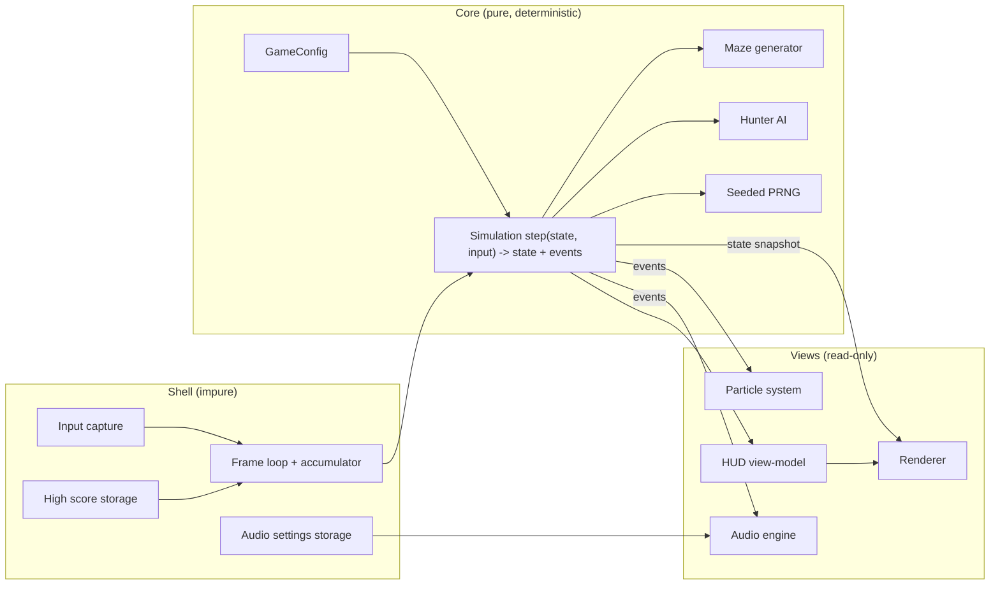
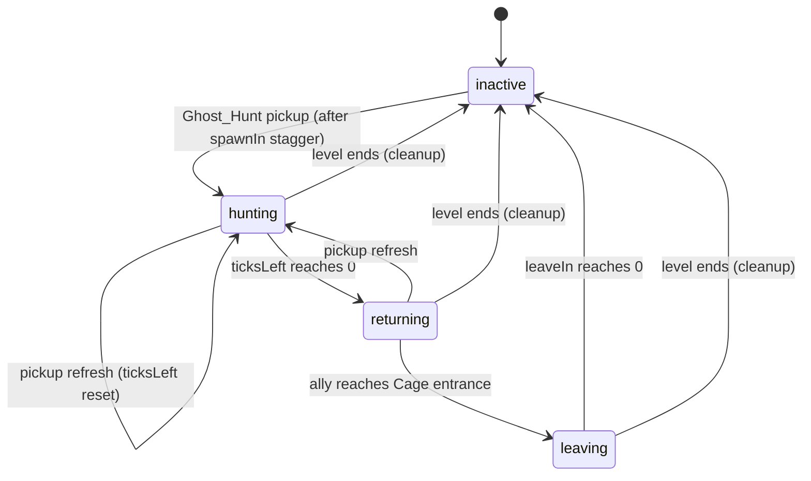
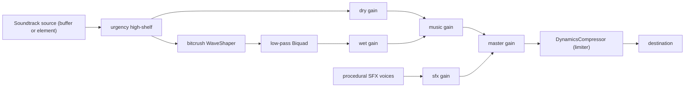

# Design Document

## Overview

KiroBit is an endless Halloween maze game. The Player is a Kiro-style ghost. Squareman is an autonomous hunter that races the Player for resources. The Player wins a level by delivering three Keys to the Cage. Squareman wins by clearing every Ordinary_Pellet.

The design rests on one rule: the Simulation is a pure, deterministic, fixed-rate state machine. Rendering, particles, audio, input capture and persistence sit outside it and only read its state or consume its events. This makes seeded balance runs, replay-style tests and fast-check properties possible (Requirements 2, 17 to 20).

Stack: TypeScript, Vite, Canvas 2D, Vitest, fast-check, Web Audio API, Node `worker_threads` (balance tooling only). No runtime dependencies beyond the browser. All Kiro artifacts live under `.kiro/` in the workspace (Requirements 1, 25.7).

This document is a plan. No implementation is part of this deliverable. Code blocks show interfaces and pseudocode only.

### Key Design Decisions

- Cell-based simulation with integer progress. Movement progress is an integer count of Ticks per Cell, so no floating-point drift enters the Simulation.
- One `GameConfig` object holds every tunable value, including all Open Design Questions.
- The Simulation emits typed events into an append-only per-Tick list. Consumers never write back.
- The generator is validate-and-repair first, regenerate second, so it terminates quickly and deterministically.
- Door scheduling is computed with a safety check against the live reachability graph, so fairness is enforced by construction and verified by property tests.
- Bombs mutate a per-level copy of the wall layer only through a pure function that returns a new tile array. Walls can only be removed, so connectivity only improves (proof in the Bombs section).
- Ghost Hunt lives in its own state slice (`GameState.ghostHunt`) that has no access to Captive flags or Carried_Keys. Rescue logic reads only the Captive flags. This separation is enforced by function signatures and a property test.
- Spirit_Wisps are a separate, seeded, non-overlapping item set. They never enter the Ordinary_Pellet count, so the two win conditions stay independent.
- The Soundtrack is the user's file `public/audio/Pixel Pulse.wav`. No music is generated. The Audio_Engine processes it with a reactive Web Audio chain and synthesizes only sound effects.
- Balance is evidence first. The Balance_Simulator measures, then calibrates, then enforces a committed baseline. Numbers such as 1.3, 3.0, 500 Mazes, 480 Ticks and 2.5 Cells are provisional until the baseline replaces them.
- Config note: Open Design Question 18 in the requirements gives a Combo window of 120 Ticks, and this design follows the requirements (`comboWindowTicks = 120`). It remains `tuning`.

## Architecture

### Layering



Rules enforced by structure and tooling:

- `src/core/**` imports nothing from `src/render`, `src/audio`, `src/input`, `src/shell` or any DOM type. The tsconfig for `core` omits the `DOM` lib so DOM globals fail to compile.
- `src/core/**` never calls `Date`, `performance`, `Math.random`, `requestAnimationFrame` or `crypto.getRandomValues`. An ESLint `no-restricted-globals` / `no-restricted-properties` rule and the determinism lint hook enforce this (Requirements 2.2, 2.4, 24.4).
- Views receive `Readonly<GameState>` (deeply readonly types) and a `ReadonlyArray<GameEvent>`.

### Module Layout

```
src/
  core/
    config.ts            GameConfig, defaults, validation
    prng.ts              mulberry32-style PRNG, seed derivation
    types.ts             Cell, Dir, GameState, GameEvent, Input
    grid.ts              coordinates, neighbors, wrap pairing
    maze/
      generate.ts        generateMaze(seed, config)
      validate.ts        validity checks (connectivity, reachability, fairness)
      repair.ts          repair passes
      carve.ts           DFS carving, cage block, loops, wall hardness flags
      doorPlacement.ts   door candidates and placement
      placement.ts       cage, starts, keys, special items (power, speed, bombs,
                         ghostHunt)
      partition.ts       wisp/pellet partition (disjoint sets, block minimums,
                         path coverage repair)
    doors.ts             schedule + safety gating + connectivity tables
    pathfinding.ts       BFS over current door state and wall layer, distance
                         fields with a version counter
    movement.ts          grid movement, buffered turns
    hunter.ts            Squareman utility AI (COLLECT / CHASE / FLEE modes)
    powers.ts            power, speed, cancellation rules
    bombs.ts             bomb pickup, detonation, wall destruction, derived-data refresh
    ghostHunt.ts         ally state machine, ally AI, start / refresh / end
    rules.ts             collisions, keys, rescue, lives, level outcome
    progression.ts       level speed, seeds, lives policy
    score.ts             score weights, wisp points, Combo state transitions
    openQuestions.ts     status registry for Open Design Questions
    sim.ts               createRun, step
    events.ts            event types and event bus helpers
    hud.ts               HUD view-model (pure)
  render/
    renderer.ts          frame composition
    staticLayer.ts       pre-rendered maze layer
    spriteCache.ts       pixel-art atlas and tinted variants
    lighting.ts          offscreen glow layer
    particles.ts         particle pool and emitters
    quality.ts           quality tier controller
    placeholders.ts      Phase 1 shape graphics
  audio/
    audioEngine.ts       AudioEngine facade: context, unlock, lifecycle, event dispatch
    buses.ts             master / music / sfx gain graph, compressor, volume + mute
    soundtrack.ts        Soundtrack loader (buffer or stream), loop, loading state, fallback
    effects.ts           reactive music chain: bitcrush WaveShaper, low-pass, dry/wet, urgency
    sfx.ts               event -> SfxId mapping and procedural voice recipes (data)
    voices.ts            voice player: oscillator / noise recipe interpreter, voice limit
    audioStore.ts        AudioSettings persistence (tolerant, StorageLike)
    audioPort.ts         AudioContextLike / AudioParamLike interfaces for mockability
  shell/
    main.ts              bootstrap
    loop.ts              accumulator loop
    input.ts             keyboard capture -> Input
    highScores.ts        High_Score_Store
    screens.ts           menu, transitions, game over
public/
  audio/
    Pixel Pulse.wav      user-owned Soundtrack, read-only for the project
tools/
  lintDeterminism.ts     determinism scanner for hook (outside src, scans src/core)
  checkSoundtrack.ts     size + SHA-256 check of the Soundtrack against ASSETS.md
  perfBrowser.ts         optional headless-browser Frame_Time check (puppeteer-core loaded
                         dynamically; prints SKIPPED and exits 0 without a browser)
  balance/
    simulator.ts         Balance_Simulator library (measure / calibrate / check)
    policies.ts          automated Player policies
    stats.ts             percentiles, ratio summary, band checks
    worker.ts            worker_threads entry
    pool.ts              worker pool, canonical chunking and merge
    cli.ts               CLI entry: measure | calibrate | check | smoke
    baseline.json        committed Balance_Baseline
tests/
  core/  maze/  doors/  hunter/  powers/  bombs/  ghostHunt/  wisps/  rules/  progression/
  render/ audio/ shell/ balance/ perf/ assets/
  fixtures/
    soundtrack.json      recorded size + SHA-256 + header facts
.kiro/
  steering/  hooks/  specs/
ASSETS.md                asset notice, Soundtrack size and checksum
```

### Frame Loop

```
accumulator += min(frameDeltaMs, maxCatchUpMs)
while accumulator >= TICK_MS (1000/60):
    input = inputQueue.snapshotForTick()
    {state, events} = step(state, input, config)
    eventBus.publish(events)
    accumulator -= TICK_MS
alpha = accumulator / TICK_MS     // used only by the Renderer
render(state, alpha)
```

The clamp on `frameDeltaMs` prevents a spiral of death after a tab switch. The clamp is a Shell concern and does not affect Simulation determinism. The number of Ticks run equals `floor(totalElapsed / TICK_MS)` for any split of elapsed time into frames, within the clamp (Requirement 2.5).

Direction presses are queued by the Shell with their arrival order. The queue is drained at the next Tick, so input reaches the Simulation no later than the next Tick (Requirement 21.2).

## Components and Interfaces

### Core Types

```ts
type Dir = 'up' | 'down' | 'left' | 'right';
type Cell = { x: number; y: number };

interface Input {
  pressed: Dir | null;       // last direction pressed this Tick
  bomb: boolean;             // true for exactly one Tick per bomb key press (Space by default)
  continue: boolean;         // level-end / game-over acknowledgement from the Shell
}

type Character = {
  id: 'player' | 'hunter';
  cell: Cell;                // cell being left (or occupied)
  next: Cell | null;         // cell being entered, null when idle
  progress: number;          // integer Ticks spent on current step, 0..ticksPerCell
  dir: Dir | null;
  buffered: Dir | null;      // Buffered_Turn (player only)
  power: number;             // remaining Ticks, 0 = none
  speed: number;             // remaining Ticks, 0 = none
  invulnerable: number;      // remaining Ticks
  respawnIn: number;         // hunter respawn countdown, 0 = alive
};

interface GameState {
  runSeed: number;
  levelNumber: number;
  tick: number;
  rng: PrngState;
  maze: Maze;
  player: Character;
  hunter: Character;
  items: ItemState;            // keys, ordinary, power, speed, bombs, ghostHunt, wisps, counts
  carriedKeys: number;
  captives: [boolean, boolean, boolean];   // released flags, written ONLY by rescue logic
  doors: DoorState[];
  bombs: number;               // Bomb_Inventory, integer 0..bombCapacity (3)
  walls: WallLayer;            // per-level copy-on-write wall layer, see Bombs
  derived: DerivedNav;         // doorMask tables, distance-field version, see Bombs
  ghostHunt: GhostHuntState;   // separate slice, no Captive flags inside
  comboCount: number;          // current Combo multiplier, 1..comboCap
  comboTicksLeft: number;      // Ticks until the Combo resets, 0 = no active window
  lives: number;
  score: number;
  phase: 'playing' | 'levelEnd' | 'gameOver';
  outcome: null | 'playerWin' | 'hunterWin';
}

interface WallLayer {
  tiles: Uint8Array;           // current tile codes; never mutated in place
  version: number;             // increments on every destruction, keys all caches
  destroyed: number;           // count of destroyed walls this level
}

interface GhostHuntState {
  ticksLeft: number;           // 0 = inactive
  allies: [Ally, Ally, Ally];  // index = Captive index 0..2
}

type AllyMode = 'inactive' | 'hunting' | 'returning' | 'leaving';

interface Ally {
  id: 0 | 1 | 2;
  cell: Cell;
  next: Cell | null;
  progress: number;            // fixed-point, same CELL_UNITS scale as Character
  dir: Dir | null;
  mode: AllyMode;
  spawnIn: number;             // staggered spawn countdown, 0 = spawned
  leaveIn: number;             // visual-only deterministic fade timer for 'leaving'
}

function step(state: GameState, input: Input, cfg: GameConfig): { state: GameState; events: GameEvent[] };
```

Tile codes: `Floor`, `Wall` (Destructible_Wall), `WallHard` (Indestructible_Wall: outer boundary, Cage perimeter, Cage interior walls), `CageInterior`, `CageGate`, `Door`. A tile is passable when it is `Floor`, `CageInterior`, `CageGate` or an open `Door`. Only `Wall` tiles are destructible, so the destructible flag is derived from the tile code and cannot drift out of sync.

Type-level separation for Ghost Hunt: `stepGhostHunt(gh: GhostHuntState, view: GhostHuntView, cfg): { gh: GhostHuntState; events: GhostHuntEvent[] }` receives a `GhostHuntView` that picks only `{ walls, doors, derived, hunter, player.cell, maze.cage, tick }`. The view type has no `captives` and no `carriedKeys` field, so ghost hunt code cannot read or write them. Rescue code in `rules.ts` receives `captives` and `carriedKeys` and never imports `ghostHunt.ts`.

`step` is a pure function. It returns a new state and does not mutate the argument. For speed, internals may use structural sharing; the contract stays pure. The 2 ms p95 budget leaves room (Requirement 21.3).

### Seeded PRNG

- Algorithm: mulberry32 over a 32-bit state. It is small, fast and has a fully specified integer implementation.
- `PrngState` is a single `number`, stored in `GameState.rng`. Every draw returns `[value, nextState]` through a thin helper, so state threading is explicit and testable.
- Substreams: `deriveSeed(runSeed, levelNumber, stream)` hashes inputs with an integer mix function (for example a splitmix32 finalizer). Streams are `maze`, `doors`, `hunter`, `repair`, and `items` (Bomb, Ghost_Hunt and Spirit_Wisp placement, so adding or tuning those never shifts the corridor layout). Separate streams keep the maze identical for a given `(runSeed, level)` regardless of how the Hunter AI consumed random values earlier (Requirement 4.1, 4.3).
- Level seed: `levelSeed = deriveSeed(runSeed, levelNumber, 'maze')`. On a Squareman win with the default policy, the Level_Number repeats, so the generator also mixes a `retryIndex` to avoid replaying the same Maze.

### Maze Generator

#### Grid and Representation

```ts
interface Maze {
  width: number; height: number;          // odd, from config (default 21x21)
  tiles: Uint8Array;                      // INITIAL tiles: Wall | WallHard | Floor | CageInterior | CageGate | Door
                                          // (immutable; the live copy-on-write layer is GameState.walls)
  doors: DoorSpec[];                      // position, phase, period, openRatio
  wrapPairs: Array<[Cell, Cell]>;         // empty by default (Requirement 3.7)
  playerStart: Cell; hunterStart: Cell;
  cage: { interior: Cell[]; entrance: Cell; };
  keys: Cell[];                           // length 3
  ordinary: Cell[]; power: Cell[]; speed: Cell[];
  bombs: Cell[];                          // bombsPerLevel (default 3), player-only
  ghostHunt: Cell[];                      // ghostHuntPerLevel (default 1), player-only
  wisps: Cell[];                          // Spirit_Wisps, disjoint from `ordinary`, player-only
  generation: { attempts: number; repairs: number };
}
```

#### Algorithm

1. Carve a perfect maze with an iterative randomized depth-first search (explicit stack, no recursion) on the odd-coordinate lattice. This guarantees a spanning tree, so the floor graph is connected by construction (Requirement 4.4).
2. Reserve a central cage block (default 5 wide by 3 tall of interior plus walls) around the grid center. Carve it out of the lattice, then connect it to the corridor network through one gate Cell, the Cage entrance. The central region is a configurable rectangle covering the middle third of each dimension (Requirement 4.6).
3. Add loops: remove `loopCount` interior walls chosen by the PRNG, each between two floor Cells that are at least `minLoopSpan` apart in the current graph distance. Default loop density removes roughly 12 percent of dead-end-forming walls, and the pass also removes all dead ends with probability `deadEndRemoval` (default 0.7) so the Hunter and Player can circle. Loops give alternative routes when Doors close.
4. Place Doors (see Door Placement below).
5. Place starts: Player and Squareman starts in opposite quadrants. Choose the two floor Cells that maximize graph distance within their candidate quadrants, with ties broken by PRNG.
6. Place Keys: three Keys in distinct regions (thirds of the Maze outside the central region), each at graph distance from the Cage entrance between `keyMinDist` and `keyMaxDist`, and each not on a Door Cell.
7. Place power and speed pellets (fairness rules below).
8. Place Bombs and Ghost_Hunt items (Special Item Placement below) from the `items` stream.
9. Partition the remaining eligible floor Cells into Spirit_Wisps and Ordinary_Pellets (Wisp and Pellet Partition below). The eligible set excludes Start_Cells, Cage interior, Cage entrance, Door Cells, Key Cells and every special item Cell.
10. Mark walls: the outer boundary, the Cage perimeter and the Cage gate frame become `WallHard`; every other wall is a destructible `Wall`.
11. Validate. If a check fails, run repair. If repair fails after `maxRepairs` passes, discard and regenerate from the next PRNG state (Requirement 4.8).

#### Door Placement

- Candidates are edges on cycles only. A candidate Door Cell is a floor Cell that is an articulation-free point: removing it leaves the floor graph connected. The generator computes this once with a low-link (Tarjan) pass and keeps only non-articulation Cells.
- Doors are spaced at least `doorMinSpacing` apart (graph distance) and are not placed adjacent to Start_Cells or the Cage entrance.
- Choose `doorCount` (default 4) by PRNG from candidates.
- A set of Doors is accepted only if the Maze stays connected when any single Door is closed, and when any pair of Doors is closed (checked by brute force; at most C(4,2)=6 pairs). This is the structural basis for fairness (Requirements 5.6, 5.7).
- Each Door receives `openRatio >= doorMinOpenRatio` (default 0.5) and a period drawn from `[doorPeriodMin, doorPeriodMax]` Ticks (Requirement 5.9).

#### Pellet Fairness Rules

- Power_Pellets: default 4, placed near the four quadrant corners, with the constraint that each is farther from both Start_Cells than `powerMinStartDist`. Placement is rotationally balanced: the Player and Squareman distances to each Power_Pellet differ by at most `powerFairnessDelta` (default 4 Cells). If no candidate satisfies this, relax the delta by one Cell per attempt, up to a cap.
- Speed_Pellets: default 3, placed on loops (cycle Cells) so that the collector has room to use the speed. Distance difference between starts is at most `speedFairnessDelta`.
- Ordinary_Pellet density: the eligible Cells that the Wisp and Pellet Partition does not assign to Spirit_Wisps. The count is recorded so the Squareman clear time can be estimated.

- Keys are never nearer to Squareman than to the Player by more than `keyFairnessDelta` (default 3 Cells), so Squareman does not camp on Keys by accident of layout.

#### Special Item Placement (Bombs and Ghost_Hunt)

- Candidates are floor Cells that are not Start_Cells, Cage Cells, Door Cells, Key Cells or other special items.
- Bombs (`bombsPerLevel`, default 3): placed from the `items` stream with three constraints: reachable with every Door open (guaranteed by the connected floor graph), graph distance from the Player start at least `bombMinStartDist` (default 6, so a Bomb is never handed out at the spawn), and spread across distinct maze thirds. Fairness is expressed relative to Squareman: because Bombs are player-only, the placement requires `dist(hunterStart, bomb) - dist(playerStart, bomb) >= -bombFairnessDelta` (default 3) so a Bomb is not placed deep in the Player's disadvantage. Candidates failing the delta are skipped; if none remain the delta relaxes by one Cell per attempt up to a cap, as for Power_Pellets.
- Ghost_Hunt (`ghostHuntPerLevel`, default 1): placed on a cycle Cell at graph distance from the Cage entrance of at least `ghostHuntMinCageDist` (default 8), so the pickup is a detour from the rescue routes and the decision to take it is a real trade-off. Same distance-delta rule as Bombs.
- Both kinds are marked player-only in `ItemState`; the Hunter's COLLECT utility never lists them as targets (Requirements 28.12, 29.2).

#### Wisp and Pellet Partition

The Maze is cut into square blocks of side `itemBlock` (default 3 Cells). Let `R` be the eligible Cells (defined in Algorithm step 9) and `R_b` the part of `R` in block `b`.

1. For each block with `|R_b| >= 2`, the Spirit_Wisp count is `w_b = clamp(round(wispDensity * |R_b|), 1, |R_b| - 1)`. So every such block holds at least one Spirit_Wisp and at least one Ordinary_Pellet. A block with `|R_b| = 1` takes an Ordinary_Pellet when its row-major block index is even and a Spirit_Wisp when it is odd, so neither kind is systematically favoured.
2. Which `w_b` Cells of the block become wisps is chosen by a seeded shuffle of `R_b` from the `items` stream.
3. A path-coverage repair pass runs over the shortest paths between key locations (Player start to each Key, each Key to the Cage entrance, Player start to the Cage entrance, Hunter start to the Cage entrance). A sliding window of `coverageWindow` Cells (default 6) along each path must contain at least `minWispsPerWindow` and `minPelletsPerWindow` (both default 1) among its eligible Cells. A violating window swaps the kind of one eligible Cell in the window (the majority kind becomes the minority kind), preferring a Cell whose swap does not violate a neighbouring window.
4. Result: `wisps` and `ordinary` are disjoint by construction, `wisps ∪ ordinary = R`, and the effective density over the whole Maze is close to `wispDensity` (exactly `wispDensity` within rounding per block). Open Design Question 18 states density 0.5 of eligible remaining Cells; this definition makes "eligible remaining" precise.
5. `minOrdinary` in the validity checks counts only `ordinary`, so a high `wispDensity` cannot starve Squareman of pellets without failing validation.

#### Validity Checks (validate.ts)

Each check returns `{ ok, reason }`. A Maze is valid only if all checks pass:

1. Floor graph with all Doors open is one connected component, and every floor Cell is reachable from the Player Start_Cell (Requirement 4.4).
2. Both starts, all Keys, every pellet and the Cage entrance are mutually reachable (Requirement 4.5).
3. Cage lies fully within the central region (Requirement 4.6).
4. Dimensions and Door count equal config values (Requirement 4.7).
5. With any one Door closed, and with any two Doors closed, every objective stays reachable from the Player Start_Cell (door fairness precondition).
6. Counts: exactly 3 Keys, `powerCount` power, `speedCount` speed, `bombsPerLevel` Bombs, `ghostHuntPerLevel` Ghost_Hunt items, at least `minOrdinary` ordinary pellets.
7. Fairness deltas respected (power, speed, key, bomb, Ghost_Hunt).
7a. Item disjointness and coverage: `ordinary`, `wisps`, Keys, special items and Start_Cells are pairwise disjoint, and the block and path coverage minimums of the Wisp and Pellet Partition hold.
7b. Wall flags: the outer boundary and the Cage perimeter are `WallHard`.
8. The estimated race ratio from a cheap analytic bound (see Balance Simulator) is within a generous pre-filter band, so obviously unbalanced layouts never reach play.

#### Repair and Regenerate Strategy

The strategy is bounded and deterministic. Every step draws from the `repair` stream.

1. Repair pass A, connectivity: if any floor Cell is unreachable, knock out the wall adjacent to the unreachable component that joins it to the main component with the shortest connecting path. This always succeeds because the lattice is rectangular.
2. Repair pass B, door safety: if a Door set fails the single or pair closure check, drop the Door that causes the failure and pick a replacement from remaining candidates.
3. Repair pass C, placement: if a pellet, Key, Bomb or Ghost_Hunt item violates a fairness delta, move it to the next candidate Cell from a PRNG-shuffled candidate list. Coverage violations are repaired by the partition swap of the Wisp and Pellet Partition.
4. After each pass, re-run validation. Stop at first success.
5. If `maxRepairs` (default 8) passes fail, discard the Maze, advance the `maze` stream, increment `attempts` and regenerate. After `maxAttempts` (default 50) the generator falls back to a fixed-shape template parameterized by the seed (a carved perfect maze with default placements and zero Doors) that is valid by construction, so generation always terminates. A test asserts the fallback is unreachable in practice for the tested seed range, and works when forced (Requirement 4.8).

Typical cost: one DFS, one loop pass, one Tarjan pass and a few BFS runs on 441 Cells, well under the 50 ms budget (Requirement 4.9).

### Door Scheduling

Each Door has a state machine:

```
open --(warn window: warnTicks >= 30)--> closing-warning --> closed
closed --(warn window)--> opening-warning --> open
```

Schedule generation:

- Each Door has `period` and `phaseOffset` from the `doors` stream. Open duration is `round(period * openRatio)`, with `openRatio >= doorMinOpenRatio`.
- `warnTicks` is at least 30 (default 40). The Simulation exposes `door.warning: 0..1` and `door.nextChangeIn` so the Renderer can animate a warning (Requirement 5.3).
- Transitions are decided at Tick time by the schedule, but gated by two safety checks before a close takes effect:
  1. Occupancy gate: if either character occupies the Door Cell or is mid-step into it, postpone the close by one Tick and repeat (Requirement 5.5).
  2. Reachability gate: compute the floor graph with the candidate state (all other Doors in their current state, this Door closed). If any objective is disconnected from the Player, or if a character would be confined, the close is allowed only if the disconnection can last no longer than `maxDisconnectTicks`. Because closed Doors reopen by schedule, the gate computes the time until the next opening of any Door that would restore connectivity. If that exceeds `maxDisconnectTicks`, the close is postponed (Requirements 5.6, 5.7).
- Postponement keeps the open ratio at or above the minimum, since postponing a close only adds open time.
- The gate uses an incrementally maintained union-find over the Door-open set. The Maze has at most about 4 Doors, so there are at most 16 Door states. The Simulation precomputes per-state connectivity masks at level start (a 16-entry table) and the time-to-restore lookup, so the per-Tick gate cost is O(1).

Door state changes also emit `DoorChanged` events, and pathfinding invalidates its cache on that event.

### Pathfinding

- Grid BFS on the unweighted 4-neighbor graph, plus wrap pairs. A closed Door is impassable.
- A shared `DistanceField` object caches BFS distance fields from the Hunter target set. It is keyed by `(doorMask, walls.version)`, where `doorMask` is the bitmask of open Doors and `walls.version` increments on every Bomb explosion that destroys at least one wall. It is recomputed only when either component changes or when the target set changes. A stale field can therefore never be served after an explosion.
- Ally pathing (Ghost Hunt) uses the same fields and the same passability function, so allies respect closed Doors, walls and destroyed walls identically to Squareman.
- Because Doors change rarely (a handful of times per minute), most Ticks reuse a cached field.
- Route recompute: on `DoorChanged` or `WallsDestroyed`, the Hunter and every Allied_Ghost clear their cached route and committed target before the next movement decision, so the next decision uses the new Door state and wall layer (Requirements 5.8, 8.7, 28.9).
- Door foresight: the pathing cost of a Door Cell that will close within `doorLookaheadTicks` (default 60) is treated as impassable for the Hunter's decision. This lets the Hunter adapt before being cut off. A Door whose nearest side the Hunter would reach after it closes is treated as closed.
- Distances are integer Cells. Ties are broken by a fixed neighbor order and then by the Hunter's PRNG draw, never by iteration order of a hash map.

### Grid Movement, Buffered Turns, Interpolation

- A character moves one Cell per `ticksPerCell` Ticks. `ticksPerCell` is derived from Level_Speed in integer Ticks-per-Cell fractions. To support fractional speeds without floats in the state, movement uses a fixed-point accumulator: `progress += speedUnits` where one Cell is `CELL_UNITS = 1000` units and `speedUnits = round(baseUnitsPerTick * levelSpeedFactor * speedMultiplier)`. All values are integers.
- Entering a Cell happens when `progress >= CELL_UNITS`. The leftover is carried to the next step, so speed is accurate over time.
- At each Cell boundary the Player resolves direction:
  1. If `buffered` is set and the Cell in that direction is passable, take it and clear the buffer (Requirement 3.3).
  2. Else if the current direction's next Cell is passable, continue.
  3. Else hold in place (Requirement 3.5).
- A direction press: if passable from the current Cell boundary now, it takes effect at the boundary. Otherwise, it is stored as `buffered`. A later press replaces `buffered` (Requirement 3.4). A press for the reverse direction applies immediately mid-step, since reversing needs no boundary.
- A character facing a closed Door holds in the Cell. It resumes when the Door opens.
- Wrap pairs: when the next Cell is part of a wrap pair, the character is placed at the paired Cell on entering. The default generator emits no wrap pairs, and the movement code supports them (Requirement 3.7).
- Interpolation: the Renderer computes `pos = lerp(cell, next, (progress + alpha * speedUnits) / CELL_UNITS)` clamped to `[0,1]`. It is a pure function in `render/interp.ts` taking `(Character, alpha)`, and it never writes into the Simulation (Requirement 3.6).

### Hunter AI (Squareman)

The Hunter makes a decision at each Cell boundary (or immediately after a `DoorChanged`/power change). The decision chooses a target Cell, then moves along the shortest path.

#### Mode Selection

```
threats = alliesHunting(state)                      // Allied_Ghosts in mode 'hunting' (spawned)
if player.power > 0 or threats.length > 0:  mode = FLEE   (Requirements 8.5, 29.6)
else if hunter.power > 0 and dist(hunter, player) <= chaseDistance: mode = CHASE   (8.6)
else:                                 mode = COLLECT             (8.2)
```

Priority and ordering: FLEE has the highest priority and is evaluated first. The flee sources are the union of the Player (only when `player.power > 0`) and every hunting Allied_Ghost. CHASE and COLLECT are therefore suppressed while any ally hunts, even when Squareman holds the Power_State, because Requirement 29.6 has no exception. Allied_Ghosts neither grant nor cancel the Power_State, so `powers.ts` never sees them (Requirement 29.13).

#### COLLECT: Utility Scoring

For each candidate target `t` among pellets (ordinary, power, speed), compute:

```
utility(t) = w_kind[kind(t)]
           + w_cluster * localPelletDensity(t, radius = 3)
           - w_dist * pathDist(hunter, t)
           + w_contest * contest(t)
           - w_risk * risk(t)
           + w_jitter * prngNoise
```

- `w_kind`: ordinary 1.0, speed 2.0, power 3.5 by default. Power is more valuable when the Player is near the Power_Pellet, since taking it denies the Player.
- `contest(t)`: positive if `pathDist(player, t) - pathDist(hunter, t)` favors the Hunter, so it prefers pellets it can win. It is negative if the Player will arrive first and the pellet is a Power_Pellet (avoid wasting time).
- `risk(t)`: if the Player could reach `t` first and the Player is likely to hold power soon (the Player is within `riskRadius` of an uncollected Power_Pellet), raise risk.
- Power awareness: if the Player is within 2 Cells of an available Power_Pellet and the Hunter cannot reach it first, apply a denial penalty to targets near the Player.
- Speed awareness: when `hunter.speed > 0`, increase `w_cluster` and lower `w_dist` so the Hunter sweeps clusters while fast. When `player.speed > 0`, increase `w_risk`.
- Choose the argmax. Ties go to the lowest index in a stable order, then to a PRNG draw. `w_jitter` is small (default 0.15) so decisions are not predictable but are fully seeded (Requirement 8.8).
- Commitment: keep the chosen target until reached, invalidated (pellet gone), or a Door change, to avoid oscillation. A hysteresis bonus `w_commit` is added to the current target.
- Pellet-clearing pace is capped by the movement speed, so the Hunter cannot outrun the balance band (Requirement 20).

#### FLEE

Evaluate each neighbor Cell. Score by distance from the nearest flee source using a multi-source BFS field (sources: the Player when it holds power, plus every hunting Allied_Ghost; larger is better), plus a bonus for cells with at least two onward exits (avoid dead ends) and a penalty for cells whose escape path passes a Door about to close. The Hunter prefers stepping to the neighbor that maximizes the Player-distance, with exits as the tie-breaker. If the Player power timer is about to expire, the Hunter does not suicide into corners.

#### CHASE

Target the Player's predicted Cell: the Cell the Player will occupy in `leadTicks` (default 12) given current direction and buffer. Path via BFS. This runs only within `hunterChaseDistance` (default 8) and only while Squareman holds power (Requirement 8.6).

#### Respawn

After being eaten the Hunter is inactive for `hunterRespawnTicks` (default 180), then reappears at the Squareman Start_Cell with a short `hunterGraceTicks` (default 30) during which it cannot be eaten again, avoiding spawn camping.

### Powers, Cancellation and Speed

All power and speed rules live in `powers.ts` and run in a fixed order inside `step` so same-Tick interactions resolve deterministically.

Per-Tick order inside `step`:

1. Apply input to the Player (buffer/turn).
2. Bomb resolution: if `input.bomb` and `bombs > 0` and phase is `playing`, detonate (see Bombs). This updates `walls`, the connectivity and time-to-restore tables, the `walls.version` counter and clears Hunter and ally routes, all inside this Tick, before anything reads them.
3. Update Door schedule and gates (using the tables from step 2 if they changed).
4. Hunter decision (mode selection includes hunting allies).
5. Ghost Hunt update: tick the effect timer, handle start, refresh and end transitions, spawn staggered allies, and make ally movement decisions (after the Hunter decision so allies read the Hunter's committed next Cell for prediction).
6. Move the Player, the Hunter and the Allied_Ghosts.
7. Resolve pickups. Order: Player first (Keys, Power, Speed, Bombs, Ghost_Hunt, Spirit_Wisps), then Hunter (Ordinary_Pellets, Power, Speed), with the tie-break described below. Each item kind carries a collector mask: Ordinary_Pellets are Hunter-only (glossary), Keys, Bombs, Ghost_Hunt and Spirit_Wisps are Player-only, Power and Speed are shared. The mask is checked in one place, so a Hunter entering a Bomb Cell leaves the Bomb untouched (Requirements 28.12, 29.2, 30.4).
8. Resolve collisions: Player versus Hunter (eating rules), then Allied_Ghosts versus Hunter (ally catches), same-Cell and swap detection.
9. Resolve Rescue at the Cage entrance (reads only `captives` and `carriedKeys`).
10. Decrement timers: power, speed, invulnerability, respawn, `comboTicksLeft` (reset Combo at 0), ally `spawnIn` / `leaveIn`.
11. Evaluate level outcome. If the level ended this Tick, run Ghost Hunt cleanup (see Ghost Hunt).
12. Emit events.

Power rules:

- Power grant: collector's `power = powerTicks` (default 300). If the opponent holds power, the opponent's `power` is set to 0 in the same step and `RoleReversed` is emitted (Requirements 9.4, 9.5).
- Single-holder invariant: the grant function is the only writer of `power`. It always zeroes the other character. A development assertion after step 5 verifies `!(player.power > 0 && hunter.power > 0)` (Requirement 9.6).
- Same-Tick double pickup: if both characters collect different Power_Pellets on the same Tick, the Player wins the tie only if its pickup was ordered first by `powerTiebreak` (config, default: alternate by `tick % 2` parity so neither side is systematically favored). The loser's pickup still consumes the pellet but grants nothing, and emits `PowerDenied`. This keeps the single-holder rule without bias. Both entering the same Cell on the same Tick is handled the same way.
- Refresh: collecting a Power_Pellet while holding power restarts the duration (Requirement 9.10).
- Expiry: at 0 the state ends and `PowerEnded` is emitted (Requirement 9.9).
- Speed: `speed = speedDurationTicks` (default 240), multiplier `speedMultiplier` (default 1.5) applied to `speedUnits` only. Refresh restarts (10.5). Speed and power can coexist (10.4). There is no code path in which speed or power changes collision with walls, Doors or visibility (10.6).

### Collision and Eaten Rules

- Collision: characters are colliding if they occupy the same Cell, or swap Cells across one boundary during a Tick (cross-through detection to avoid tunneling).
- If `player.power > 0` and the Hunter is alive and not in grace: Hunter is eaten. Score `+eatScore`, schedule respawn, emit `HunterEaten { by: 'player' }`.
- If a hunting Allied_Ghost occupies the Hunter's Cell or swaps Cells with it, and the Hunter is alive and not in grace: the same eaten handler runs with `by: 'ally'` and the ally id. The eaten-Squareman score goes to the Player (Requirement 29.7). Allies never trigger the Player-eaten branch (Requirement 29.8): collision between an ally and the Player is not evaluated at all.
- `player.power > 0` is irrelevant to ally catches, and an ally catch does not touch either `power` field.
- Else if `hunter.power == 0 && player.power == 0` (neutral) or `hunter.power > 0`: the Player is eaten unless `player.invulnerable > 0` (Requirements 9.1, 11.8).
- Player eaten: `lives -= 1`, carried Keys dropped (see below), `comboCount = 1` and `comboTicksLeft = 0`, Player respawns at Start_Cell with `invulnerabilityTicks` (default 120), Hunter retains its position, `PlayerEaten` event. Bomb_Inventory is kept. An active Ghost Hunt continues unchanged (Ghost Hunt section). At `lives == 0`, phase becomes `gameOver` (Requirement 11.6).
- Dropped Keys: each carried Key is placed at the nearest reachable floor Cell to the death position (BFS with current Doors treated as open), skipping Cells holding another Key and never inside the Cage. Ties are resolved by fixed neighbor order. Reachability is guaranteed by the maze invariant that the open-Door graph is connected (Requirement 11.4).
- The consequences listed as Open Design Questions come from config: `hunterWinConsequence`, `livesResetPolicy`, `pelletStarvedPolicy`, `gameOverPolicy`. Each is an enum with a default and a switch in `progression.ts`.

### Keys, Cage and Rescue

- Entering a Key Cell: `carriedKeys += 1`, key item removed, `KeyCollected` event.
- Entering the Cage entrance with `carriedKeys > 0`: let `n = min(carriedKeys, unreleasedCount)`; release the next `n` Captives in index order, set `carriedKeys -= n`, emit one `CaptiveReleased` event per release (Requirements 7.4, 7.8).
- Without Keys, entering the entrance changes nothing (7.9).
- When all three are released: `phase = 'levelEnd'`, `outcome = 'playerWin'` (7.6).
- Captive release flags are monotone for the level.

### Bombs

Implemented in `bombs.ts`, called from `step` at the points listed in the Per-Tick order.

#### Pickup and Inventory

- Entering a Bomb Cell with `bombs < bombCapacity` (3): remove the Bomb from `items`, `bombs += 1`, emit `BombCollected`. With `bombs == 3` the Bomb stays on the Cell and nothing changes (Requirements 28.1, 28.2). Inventory is an integer in 0..3 by construction (guarded increment and guarded decrement).
- Bombs persist across a Player-eaten event and are discarded with the level. Squareman cannot collect Bombs (collector mask).

#### Detonation (pure function)

`detonate(state, cfg) -> { walls', bombs - 1, destroyed: Cell[], events }`:

1. Preconditions: `input.bomb`, `bombs > 0`, `phase == 'playing'`. Otherwise no change (Requirement 28.4).
2. Blast centre: the Player's exact position in fixed-point cell-units, `P = (cell + (next - cell) * progress / CELL_UNITS) * CELL_UNITS`, so a Bomb used mid-step is centred on the visible Player and the computation stays in integers.
3. Radius: `R = round(bombRadius * CELL_UNITS)`, so 2.5 Cells is 2500 units and the test is `dx*dx + dy*dy <= R*R` in integer arithmetic, with `(dx, dy)` the offset from `P` to the centre of the candidate Cell. The test is a circle on Cell centres and ignores line of sight, so it passes through walls (Requirement 28.5).
4. Candidates are the Cells in the bounding box of the circle, clipped to the Maze bounds. For each candidate, the tile is destroyed only if its code is `Wall` (destructible) and the circle test passes. `WallHard`, `CageGate`, `CageInterior` and `Door` tiles are never changed. Floor Cells, items, characters and pellets are untouched (Requirements 28.7, 28.13).
5. Door Cells are unaffected by decision. A Door is a scheduled mechanic under Simulation control (Requirement 5.2), and treating it as a wall would make the Door schedule, the 16-entry connectivity tables and the occupancy gate ambiguous. A Door Cell inside the blast keeps its schedule.
6. Result: `walls'` is a new `WallLayer`: a copy of the tile array with destroyed Cells set to `Floor` (copy-on-write, the previous array is never mutated, so `step` stays pure), `version + 1`, `destroyed + n`. If `n == 0` the explosion still consumes the Bomb and emits `BombDetonated` with an empty list, but `version` is unchanged and no caches are invalidated.
7. A destroyed Cell with no passable neighbour is an isolated pocket: it is `Floor` but unreachable. Pockets are legal. They hold no items, and every invariant that mentions reachability is stated over the Cells that were passable before the explosion and the objective Cells.

#### Derived-Data Refresh (same Tick)

When `n > 0`, in this order and in the same `step` call:

1. Recompute the 16-entry (generally `2^doorCount`) `doorMask` connectivity table from `walls'` with a union-find per mask. Cost: `2^doorCount * W * H`, about 7,000 Cell visits at defaults, well inside the Tick budget and executed only on explosions.
2. Recompute the time-to-restore table from the connectivity table and the Door schedules.
3. Increment `walls.version`, which invalidates every `DistanceField` (cache key includes the version).
4. Clear the Hunter's cached route and committed target, and every Allied_Ghost's route (`routeVersion` mismatch), so decisions in steps 4 and 5 of the same Tick use the new layer (Requirement 28.9).
5. Emit `BombActivated` (at the Player position), `BombDetonated { cell, radius, destroyed }` and, when `n > 0`, `WallsDestroyed { cells }`.
6. In development builds, `assertValidState(state)` re-checks: all coordinates in bounds; the Cage walls, gate and interior are unchanged; no character stands on a wall; every item Cell is passable; every Door Cell is still a Door; every Key, pellet and special item is reachable from the Player with all Doors open.

#### Why Destruction Preserves Connectivity and Door Safety

Let `G` be the passability graph before and `G'` after an explosion for any fixed `doorMask`. Destruction only turns `Wall` tiles into `Floor`, and passability of every other tile is unchanged, so the passable set only grows: `P ⊆ P'`. Every edge of `G` joins two Cells of `P` and exists in `G'` as well, so `E ⊆ E'` for every `doorMask`. A path in `G` is a path in `G'`, hence:

- Reachability sets only grow, so every objective stays reachable from the Player whenever it was reachable before.
- The disconnection duration of any (objective, Player) pair under any Door schedule can only shrink, because the set of masks under which the pair is connected only grows. The reachability gate and the `maxDisconnectTicks` bound therefore still hold with the recomputed tables, and a Door close that the gate allowed before is still allowed.
- A character confined with no exit before keeps its exit, and a character never becomes confined because the neighbour set of a Cell never shrinks.

This is monotone safety, not fairness. Distances shrink asymmetrically: a shortcut can shorten the Player's rescue route more than Squareman's pellet route, or the reverse, and a hunter shortcut can open a wall into a pellet cluster. So the race ratio is not invariant. The Balance_Simulator therefore runs `bombAggressive` and `bombNone` policy sets, and `bombRadius`, `bombsPerLevel` and `bombFairnessDelta` are calibration outputs (Balance section).

#### Renderer Impact

The static layer is invalidated per tile: on `WallsDestroyed` the renderer redraws the destroyed Cells and their 8 neighbours (to refresh autotiled wall edges and shadows) into the offscreen static canvas with `staticLayer.patch(cells)`. A circle of radius 2.5 covers at most about 21 Cells, so the patch touches fewer than 100 tiles; a full redraw is needed only on resize. HUD shows three bomb slots.

### Ghost Hunt

Implemented in `ghostHunt.ts` with the types from Core Types.

#### Separation From Rescue

- `GameState.ghostHunt` is the only state the module writes. Its function signature takes a `GhostHuntView` without `captives` or `carriedKeys` (type-level separation), and `rules.ts` imports neither `ghostHunt.ts` nor `Ally`. Rescue logic reads only `captives` and `carriedKeys`.
- Cage presentation is derived: Captive `i` is drawn inside the Cage when `!captives[i] && ghostHunt.allies[i].mode === 'inactive'`, and drawn as a released ghost nowhere in the Cage when `captives[i]`. Ghost Hunt therefore never needs to write a Captive flag to show or hide a ghost.
- Property: for any state and any Ghost Hunt start, refresh or end, `captives` and `carriedKeys` are deeply equal before and after the Ghost Hunt update (Property 38).

#### Lifecycle



- Start: the Player enters a Ghost_Hunt Cell. The item is removed, `ticksLeft = ghostHuntTicks`, `GhostHuntStarted { refresh: false }` is emitted, and nothing is stored in an inventory (Requirement 29.1). Ally `i` gets `spawnIn = i * allyStaggerTicks` (default 20), `cell` = the Cage entrance, `mode = 'hunting'`. While `spawnIn > 0` the ally is held at the entrance and is not yet a flee source or a catcher. All three allies spawn, rescued and imprisoned alike (Requirement 29.3).
- Refresh: collecting another Ghost_Hunt while `ticksLeft > 0`, or while allies are still `returning` or `leaving`, sets `ticksLeft = ghostHuntTicks`, emits `GhostHuntStarted { refresh: true }`, switches `returning` allies back to `hunting` (they resume from where they stand), and spawns `inactive` allies with the stagger (Requirement 29.14).
- End: when `ticksLeft` reaches 0, emit `GhostHuntEnded { reason: 'expired' }` and set every ally in `hunting` to `returning` (an ally still in `spawnIn > 0` becomes `inactive` immediately).
- Returning: the ally paths to the Cage entrance by BFS over the current Doors and walls. On reaching the entrance it enters `leaving` with `leaveIn = allyLeaveTicks` (default 30). `leaving` is purely visual and deterministic: the ally stays on the entrance Cell and fades for `leaveIn` Ticks, is non-colliding and non-solid, then becomes `inactive`. Termination bound: BFS length is at most `W*H` Cells, so every ally is `inactive` within `W*H*ticksPerCell + allyLeaveTicks` Ticks of the end (Property 40).
- After `inactive`, a rescued ally (`captives[i] === true`) is simply absent, and an imprisoned ally (`captives[i] === false`) is drawn inside the Cage again by the derived rule above. Captive visuals are restored without touching the flag (Requirements 29.9, 29.10, 29.11).
- Entrance never blocked: allies are non-solid for every character and not part of any occupancy gate. The Rescue check depends only on the Player entering the entrance Cell, and the Door occupancy gate counts only the Player and the Hunter, so an ally on the entrance or on a Door Cell can neither block Rescue nor postpone a Door (Requirement 29.12).
- Level ends mid-hunt (Player win, Hunter win, or game over): in step 11 the update sets `ghostHunt` to the empty state (`ticksLeft = 0`, all allies `inactive`) and emits `GhostHuntEnded { reason: 'levelEnd' }` once. Captive flags are left as the level result. The next level starts from the empty state.
- Player eaten mid-hunt: the hunt continues unchanged, allies do not react to the Player, and the Player keeps no ghost-hunt resources. Squareman keeps fleeing.

#### Ally AI

- Speed: `allySpeedUnits = round(baseSpeedUnits * levelSpeedFactor * allyFactor)`, with `allyFactor` default 1.1 (config, tuning). The Level_Speed factor is the same one the Player and Squareman use.
- Target: BFS shortest path over the current Doors and walls to a predicted Hunter Cell. Ally `i` uses lead `leadTicks * i` (0, 12, 24 Ticks by default, `allyLeadTicks`), where the predicted Cell is walked forward along the Hunter's current direction and committed next Cell. The three leads give a pincer: one ally chases, two cut off. If the Hunter is inactive (respawning), allies move toward the Squareman Start_Cell and wait within `allyHoldRadius` Cells of it.
- Ties break by fixed neighbour order, then by the `hunter` substream. No unseeded randomness.
- Catch: same Cell or swap with an alive, non-grace Hunter calls the shared eaten handler with `by: 'ally'`. Respawn follows the existing rule (`hunterRespawnTicks`, `hunterGraceTicks`). Score goes to the Player (`scoreWeights.hunterEaten`).
- Allies cause no harm to the Player and never interact with items or Doors.

#### Squareman Behaviour and Power Interaction

Squareman switches to FLEE with allies as sources as described in Hunter AI. `powers.ts` has no reference to allies, so Ghost Hunt cannot grant, cancel, replace or refresh any Power_State (Requirement 29.13).

#### Duration Calibration

`ghostHuntTicks = 480` is a provisional placeholder. The Balance_Simulator's `calibrate ghostHunt` command sweeps durations and records the choice and evidence in the Balance_Baseline (Balance section).

#### Allied Palettes and Identity

Allies use the same Kiro-style sprite as the Player and Captives, so one atlas builds all variants. The Player is white. The three allied palettes are distinct from white and from each other, and each matches its Captive's colour so the player reads an ally as "that captive set free": ally 0 pink (`#ff6fb5`), ally 1 cyan-teal (`#3fd6c6`), ally 2 orange (`#ff9f43`). Wisps use cool cyan and violet, so ally 1 keeps a darker teal body and a two-colour trail to stay distinct from wisp glow. Allied trails and particles use the ally's own colour at reduced alpha. Palette values are provisional art decisions that live in the visual-identity steering file.

### Spirit Wisps and Combo

Implemented in `placement.ts` (generation, see Wisp and Pellet Partition) and `score.ts` (scoring).

- Collection: the Player entering a Wisp Cell removes the Wisp, updates the Combo, awards points and emits `WispCollected { cell, combo, points }`. Squareman never collects a Wisp (collector mask).
- Combo update, in `score.ts`, pure:

```
if comboTicksLeft > 0: comboCount = min(comboCap, comboCount + 1)
else:                  comboCount = 1
comboTicksLeft = comboWindowTicks
points = wispPoints * comboCount
score += points
```

- Every Tick, `comboTicksLeft` decrements to 0; reaching 0 sets `comboCount = 1` and emits `ComboReset`. A Player-eaten event resets the Combo too (Requirement 30.7). Defaults: `wispPoints = 20`, `comboWindowTicks = 120`, `comboCap = 5`.
- Accounting: Wisps live in `items.wisps` with a separate counter. `items.ordinaryRemaining` is never touched by a Wisp pickup, and the level outcome check reads only `ordinaryRemaining` and the Captive flags. The Combo affects `score` only, so win conditions and fairness are unchanged (Requirements 30.5, 30.8).
- Visual identity: Wisps are cool cyan and violet glowing orbs with a slow bob and a soft additive glow, Ordinary_Pellets are warm amber squares. The two palettes differ in hue and shape so they are readable at the lowest quality tier.

#### Coverage Verification Test

The partition and coverage guarantees are verified, not assumed:

1. Partition the Maze into blocks of side `B` (config `coverageBlock`, default 4) aligned to the grid. For each block with at least `m` eligible Cells (default 3), assert `wisps >= kMin` and `ordinary >= kMin` (default 1) over many Seeds.
2. For each pair among {Player start, three Keys, Cage entrance, Hunter start}, take the shortest path and slide a window of `coverageWindow` Cells; assert every window with at least 3 eligible Cells holds at least one Wisp and at least one Ordinary_Pellet.
3. Assert disjointness and `wisps ∪ ordinary = eligible`.
4. Report the minimum, 5th percentile and mean per-block and per-window counts for the balance report, and fail if the 5th percentile falls below the committed bound.

### Level Outcomes and Endless Progression

- Level speed: `levelSpeedFactor(n) = min(speedCap, 1 + speedIncrement * (n - 1))`, defaults 3 percent and 160 percent. It is the same factor for the Player and Squareman (Requirement 12.2). At the cap, the per-Tick movement stays below one Cell per Tick by construction (`CELL_UNITS` vs max units per Tick), and a config validation test asserts that the capped maximum speed with Speed_State is still turnable at 60 Hz (Requirement 12.6).
- Player win: `levelNumber += 1`, new Maze from `deriveSeed(runSeed, levelNumber)`, award `levelWinScore`, and one extra life every 5 levels under the default `livesResetPolicy` (Open Design Question 4).
- Hunter win: default consequence is `lives -= 1`, new Maze at the same Level_Number with a new `retryIndex` (Open Design Questions 5 and 6). If lives reach 0, game over.
- Competing victory conditions: the outcome is evaluated once per Tick in step 11, after pickups and Rescue. If the third Captive is released and the last Ordinary_Pellet is collected on the same Tick, the Player win takes precedence (`simultaneousWinTieRule`, default `playerWins`). Wisp pickups cannot satisfy or block either condition.
- There is no victory phase in the `phase` union type, so no final level exists by construction (12.3).
- The level end screen shows outcome and Level_Number from state before the next level begins (12.7). The Shell, not the Simulation, controls the transition timing; the Simulation sits in `levelEnd` until it receives a `continue` Input.

### Event Bus

```ts
type GameEvent =
  | { t: 'PelletCollected'; kind: 'ordinary'|'power'|'speed'; by: Who; cell: Cell }
  | { t: 'WispCollected'; cell: Cell; combo: number; points: number }
  | { t: 'ComboReset'; reason: 'expired'|'playerEaten' }
  | { t: 'BombCollected'; cell: Cell; inventory: number }
  | { t: 'BombActivated'; cell: Cell }                       // Player position at activation
  | { t: 'BombDetonated'; cell: Cell; radius: number; destroyed: Cell[] }
  | { t: 'WallsDestroyed'; cells: Cell[] }                   // only when destroyed.length > 0
  | { t: 'GhostHuntStarted'; refresh: boolean; ticks: number }
  | { t: 'GhostHuntEnded'; reason: 'expired'|'levelEnd' }
  | { t: 'KeyCollected'; cell: Cell }
  | { t: 'CaptiveReleased'; index: 0|1|2 }
  | { t: 'RoleReversed'; to: Who }
  | { t: 'PowerStarted'|'PowerEnded'|'SpeedStarted'|'SpeedEnded'; who: Who }
  | { t: 'DoorWarning'|'DoorChanged'; doorIndex: number; open: boolean }
  | { t: 'PlayerEaten'; cell: Cell; keysDropped: number }
  | { t: 'HunterEaten'; cell: Cell; by: 'player'|'ally'; allyId?: 0|1|2 }
  | { t: 'LevelStarted'; level: number; speedFactor: number }   // audio urgency, HUD
  | { t: 'LevelEnded'; outcome: 'playerWin'|'hunterWin'; level: number }
  | { t: 'GameOver'; score: number };
```

- The Simulation returns events as plain data in an array. Events are frozen objects with no references to mutable state.
- `EventBus` in the Shell fans the array out to subscribers synchronously after the Tick batch: Particle_System, Audio_Engine and screen controllers.
- Subscribers receive `Readonly` data and have no handle to the mutable state. A test passes deep-frozen state to handlers and asserts no throw and equal snapshots (Requirements 2.7, 19.11).

### Rendering Pipeline

Layers per frame, in order:

1. Static maze layer: an offscreen canvas rendered once per level (walls, floor tiles, decoration). Drawn with one `drawImage` (Requirement 21.4).
2. Item layer: pellets (warm amber squares), Spirit_Wisps (cool cyan and violet glowing orbs), Keys, Bombs, Ghost_Hunt items, Cage contents (Captives drawn by the derived rule in Ghost Hunt), drawn per frame from sprite atlas (dynamic because items disappear). Items with animation use frame index from `state.tick`.
3. Door layer: Doors with open/closed art, warning pulse using `door.warning`, and color change (Requirements 5.3, 5.4, 14.3).
4. Characters: interpolated positions. Power blink uses `tick % blinkPeriod`, distinct from invulnerability blink (different period and tint). Squareman is drawn with a fixed square sprite set in every frame and every state, so the silhouette never changes (Requirement 6.5).
4a. Allied_Ghosts: drawn after the Hunter and before particles, each with its allied palette, a trailing ghost-fade afterimage and a `leaving` fade alpha from `leaveIn / allyLeaveTicks`. Interpolated with the same pure `interp` function.
5. Particles: from the particle pool, including explosion debris, wisp sparkles and ally trails.
5a. Explosion layer: a short pixel-art flash and shockwave ring drawn from `BombDetonated` (render-side timer, not Simulation state), plus debris particles at each destroyed Cell.
6. Lighting: offscreen glow layer composited with `globalCompositeOperation = 'lighter'` (Phase 2). An explosion adds one short-lived large light (radius from the event, decaying over about 18 frames). Wisps and allies add small lights.
7. HUD and overlays: from `hud.ts` view-model, now including the three bomb slots, the Ghost_Hunt remaining time bar, and the Combo multiplier with its window bar.

Screen shake is applied as a final render-side translate of the composed frame. Its offset is a decaying function of render-side frame time and the event's blast strength, not a Simulation value, and it never uses the Simulation PRNG. `screenShake` in config and the player's Reduced motion setting disable it. It stays on at every quality tier: it costs one translate per frame, and disabling it at the low tier made it invisible on modest hardware (second playtest).

Static layer patching: the static maze canvas is not redrawn when walls are destroyed. `staticLayer.patch(cells)` redraws the affected tiles and their 8 neighbours using the current `walls.tiles`, so the Renderer treats `WallsDestroyed` as the only static-layer invalidation event besides resize and a new level.

Phase 1 uses `placeholders.ts` (flat colored shapes). Phase 2 swaps in the sprite atlas behind the same `drawCharacter/drawItem` interface.

#### HUD View-Model

`buildHud(state, cfg)` is pure and returns lives, level number, carried Keys, released Captives, remaining Ordinary_Pellets (never Wisps), the remaining power and speed seconds per character, the Bomb_Inventory as three slots (`filled: boolean[3]`), the remaining Ghost_Hunt seconds, and the Combo multiplier with its remaining window fraction. The Renderer only draws this structure (Requirements 7.7, 13.2, 13.3).

### Performance Plan

- Sprite cache: pixel art is defined as small palette-indexed arrays in code (original art, Requirement 22). At startup, each sprite is rasterized once into an atlas canvas, including tinted Captive variants and flipped frames. Per-frame cost is `drawImage` from the atlas. Image smoothing disabled, integer pixel coordinates after scaling.
- Static layer: maze drawn once into an offscreen canvas per level; redrawn fully only on resize or new level, and patched per tile after `WallsDestroyed`.
- Particle pool: a fixed-size struct-of-arrays (`Float32Array` for x, y, vx, vy, life; `Uint8Array` for kind) allocated once with capacity `particleCap` (default 500). Spawning takes the next free slot, or drops the particle if full. No allocations per frame (Requirements 14.6, 21.5). Particle randomness uses a separate non-simulation PRNG so effects never touch the Simulation PRNG.
- Effect budgets for the new mechanics: an explosion spawns at most `explosionParticleMax` (default 60) particles, drawn from the same pool and cut by the active cap, so it cannot exceed `particleCap`. Concurrent explosion flashes are capped at 3. Allies add at most `allyTrailMax` (default 12) trail particles each per second, reduced by the quality tier. Wisp sparkles use 4 particles per pickup. Patching the static layer costs under 100 tile blits per explosion, which fits in one frame. Screen shake is a single `translate` per frame.
- Simulation cost of the new mechanics: detonation is O(circle area), at most about 21 Cells, plus the table refresh (about 7,000 Cell visits at 4 Doors) that happens only on explosions. Ghost Hunt adds three BFS-field lookups per Cell boundary, served from the version-keyed cache. Both are covered by the 10,000-Tick perf test, which includes scripted bomb and Ghost Hunt events.
- Offscreen glow layer: lights are small pre-rendered radial gradient sprites blitted with additive blending into a half-resolution canvas, then upscaled and composited once per frame. Number of lights is bounded by item and character counts. Glow is skipped at the low tier.
- Dirty tracking: the HUD is re-rendered to its own small canvas only when its view-model changes.
- Quality controller: measures Frame_Time with a rolling window of 120 frames. If p95 > 16.7 ms for 2 consecutive seconds, step the tier down (high to medium to low). Tiers map to: glow on/off and resolution, particle cap multiplier, trail density, screen shake on/off. Tiers never touch the Simulation (Requirement 21.6). Recovery up-tiering uses a longer hysteresis (10 s) to avoid flapping.
- Simulation cost: typed arrays for tiles; distance fields cached by Door mask; no per-Tick allocation in hot paths other than the new state object. A Vitest perf test runs 10,000 Ticks and asserts p95 < 2 ms (Requirement 21.7).
- Browser perf harness: a `?perf=1` query mode runs a scripted bot for 30 seconds, records Frame_Time via `requestAnimationFrame` deltas and input latency via `event.timeStamp` to next Tick consumption, then prints pass or fail against the budgets (Requirement 21.8).

### Audio Design

The music is the user's Soundtrack, `public/audio/Pixel Pulse.wav`. The Audio_Engine plays it, processes it reactively and synthesizes only sound effects. The earlier procedural music scheduler, pattern generator and tempo mapping (`music.ts`, `scheduler.ts`, `bpm(levelNumber)`) are removed (Requirements 15.2, 26.2). The Audio_Engine subscribes to the event bus only and has no reference to Simulation state (Requirements 26.13, 2.7).

#### Soundtrack Facts and Integrity

Read from the actual file header (first 64 bytes, read-only) and the file system:

| Fact | Value | Source |
|------|-------|--------|
| Size | 33,926,694 bytes (about 32.4 MiB) | file system |
| SHA-256 | `137D2DF0ABD3C5ED079D0B1B80858D7F14C4D0AE1E9C4DC43A2F5BBC7AE13147` | read-only hash |
| Container | RIFF/WAVE, `fmt ` chunk of 16 bytes, then a `LIST`/`INFO` chunk of 88 bytes, then `data` | header bytes |
| Format | PCM (tag 1), 2 channels, 48,000 Hz, 16-bit (byte rate 192,000, block align 4) | header bytes |
| Duration | about 176.7 s (data bytes about 33,926,554 / 192,000) | derived |
| Decoded size | about 67.9 MB as Float32 stereo at 48 kHz (176.7 s x 48,000 x 2 x 4 B); about 62 MB if the context runs at 44.1 kHz and the decoder resamples | derived |

The `data` chunk offset is derived assuming the `LIST` chunk precedes it, as the header shows; the implementation test re-reads the header and asserts the format facts, so a wrong assumption fails a test and does not pass silently.

The integrity test (`tests/assets/soundtrack.test.ts`) reads the file size and SHA-256 with Node `fs` and `crypto` (read-only) and compares them to `tests/fixtures/soundtrack.json`, which is mirrored in `ASSETS.md`. The fixture is written once by a task that reads the file, never by a script that writes to it. No task opens the file for writing, moves it, re-encodes it or deletes it (Requirements 26.3, 26.4, 32.5). The Kiro hook for `public/audio` only runs this read-only test. If the file is later replaced by the owner, the test fails until the owner updates the fixture deliberately.

URL: the file name has a space, so the runtime URL is built as `new URL('audio/Pixel%20Pulse.wav', baseUrl).href` (equivalently `encodeURI('/audio/Pixel Pulse.wav')`). Vite serves `public/` at the site root, so the request path is `/audio/Pixel%20Pulse.wav`, and `import.meta.env.BASE_URL` is the base (Requirement 26.1). A unit test asserts the URL contains `%20` and no raw space.

#### Playback Decision: Decoded Buffer Primary, Streamed Element Fallback

| Aspect | `decodeAudioData` + `AudioBufferSourceNode` (loop) | `HTMLAudioElement` + `MediaElementAudioSourceNode` |
|--------|-----------------------------------------------------|----------------------------------------------------|
| Loop seam | Sample-accurate and gapless when `loop = true` on the source | Browser dependent; commonly an audible gap of tens to hundreds of ms at the loop point |
| Memory | About 62 to 68 MB of PCM for this file, held for the session | Small, decoded as a stream |
| Start latency | Download plus decode before first play (a second or more for 32 MB) | Starts after a small buffer |
| Rate and filter control | `playbackRate` AudioParam, sample-accurate ramps | `playbackRate` property, not an AudioParam, no sample-accurate ramps |
| Failure modes | Decode out-of-memory or `EncodingError` on constrained devices | Autoplay policy, network stalls |
| Test with a mock context | Straightforward | Needs an element mock |

Decision: decode into an `AudioBuffer` and loop with `AudioBufferSourceNode.loop = true` as the primary method. Rationale: this is a three-minute, 48 kHz composition meant to repeat for the whole session, and Requirement 26.8 asks for the smallest audible gap, which only the buffer path guarantees. About 68 MB of PCM is acceptable for a laptop-class browser, and the game itself holds a few megabytes. The AudioParam `playbackRate` also allows the urgency ramps to be smooth and testable.

Fallback chain, controlled by `soundtrackMethod: 'auto' | 'buffer' | 'stream'` (default `auto`):

1. `buffer`: fetch with a `ReadableStream` reader to report byte progress from `Content-Length`, concatenate, `decodeAudioData`. Guard with `soundtrackLoadTimeoutMs` (default 30,000) for fetch plus decode.
2. On `fetch` failure, a decode error, a rejected promise or timeout: switch to `stream`. Create an `HTMLAudioElement` with `src` the encoded URL, `loop = true`, `preload = 'auto'`, `preservesPitch = false` (so the rate behaves like the buffer path), connect with `createMediaElementSource`. The loop gap is accepted in this mode and the loading state says nothing about it.
3. If streaming also fails (`error` event or `play()` rejection other than autoplay), enter `silent` mode: no music, sound effects continue, state is `failed`, one `console.warn`, no thrown error (Requirement 26.7).

Loading state: `SoundtrackState = { status: 'idle'|'loading'|'decoding'|'ready'|'streaming'|'failed'; progress: number; method: 'buffer'|'stream'|'none' }`, exposed as a read-only observable. The loading state starts when the context is created. It is drawn as a small, non-blocking indicator in the HUD or menu corner ("Loading music", a progress bar for download, indeterminate during decoding). The Game stays fully playable and sound effects run while it loads (Requirement 26.6). When the state becomes `ready`, music starts at the next opportunity from time zero and loops. The load begins once the first user gesture creates the context, or earlier with a preload `fetch` of the bytes that does not need a context (the bytes are kept and decoded when the context exists).

#### Audio Graph



- Music bus: source, urgency high-shelf, a parallel dry path and a wet path (WaveShaper bitcrusher then a low-pass Biquad), the two paths summed into the music gain. The dry/wet pair is an equal-power crossfade, `dry = cos(mix * pi/2)`, `wet = sin(mix * pi/2)`, with `mix` in 0..1 (0 is the untouched Soundtrack). Idle state is `mix = 0`, so the wet path is silent and the Soundtrack passes through dry.
- SFX bus: voices into the sfx gain. Both buses then feed the master gain, then a `DynamicsCompressorNode` configured as a limiter (threshold -6 dB, ratio 12, fast attack, knee 0), then the destination. This protects against clipping when many effects overlap with the music (Requirement 27.1).
- Buses are created once in `buses.ts` and exposed as `AudioBusSet { master, music, sfx }` of `GainNode`s with `setVolume`, `setMuted` methods that use `setTargetAtTime` (10 ms) to avoid zipper noise.
- Defaults (`audioDefaults`): master 0.8, music 0.55, sfx 0.9, so effects stay audible over the Soundtrack (Requirement 27.6).

#### Key Pickup Bitcrush

On `KeyCollected` the engine calls `effects.triggerCrush(now)`:

```
t0 = ctx.currentTime
mix.cancelScheduledValues(t0); mix.setValueAtTime(currentMix, t0)
mix.linearRampToValueAtTime(crushIntensity, t0 + attack)          // attack 15 ms
mix.setTargetAtTime(0, t0 + attack + hold, release / 4)           // smooth return
// total duration ~ soundtrackDistortionMs (250 ms): attack 15 + hold 60 + release 175
lowpass.frequency: setValueAtTime(18000) ... linearRamp to crushLowpassHz (3500) ... setTarget back to 18000
```

- Configurable: `soundtrackDistortionMs` (default 250), `soundtrackDistortionIntensity` (default 0.35, the peak wet mix, a low intensity so the music stays recognisable), `soundtrackCrushBits` (default 5, shaping the WaveShaper curve), `soundtrackCrushLowpassHz` (default 3500).
- The WaveShaper curve is a quantisation staircase of `2^bits` steps generated once into a `Float32Array` and set as `curve` with `oversample = 'none'`. The low-pass emulates the sample-rate reduction of a bitcrusher. The path needs no AudioWorklet.
- Optional enhancement: where `ctx.audioWorklet` exists, a sample-and-hold bitcrusher worklet may replace the WaveShaper (Requirement 26.10). It is behind `soundtrackCrusher: 'waveshaper' | 'worklet'`, defaults to `waveshaper`, and a failed `addModule` falls back to the WaveShaper chain silently. The mock-context tests target the WaveShaper chain.
- Retrigger: a second key within the window restarts the ramp from the current mix value, never from a hard reset, so rapid pickups cannot click. Ramps are always scheduled on `AudioParam`s with `cancelScheduledValues` first so automation cannot stack.
- Because the effect is processed after the source and before the music gain, it works identically for the buffer and stream paths.

#### Urgency With Level_Speed

`LevelStarted { speedFactor }` calls `effects.setUrgency(speedFactor)`:

```
u       = clamp((speedFactor - 1) / (speedCap - 1), 0, 1)               // 0 at level 1, 1 at the cap
rate    = 1 + soundtrackMaxRateShift * u                                // default max +0.05
shelfDb = soundtrackUrgencyShelfDb * u                                  // default max +2 dB high shelf at 4 kHz
source.playbackRate.setTargetAtTime(rate, now, 1.0)
shelf.gain.setTargetAtTime(shelfDb, now, 1.0)
```

- `soundtrackMaxRateShift` default 0.05 and hard-capped at 0.08 by `validateConfig`. At 1.05x the pitch rises by under a semitone, which keeps the composition recognisable. `soundtrackUrgency: 'off' | 'rate' | 'rate+filter'` (default `rate+filter`) disables or limits it. `off` leaves rate 1 and shelf 0 dB.
- The mapping is monotone and bounded: for speed factors a <= b, `rate(a) <= rate(b) <= 1 + maxRateShift` (Property 25).
- On a stream-element source the rate is set once on `element.playbackRate` at level start (no ramp, since the property is not an AudioParam); the shelf still ramps. This is the only place the stream path differs.
- SFX layers for urgency are optional: while the remaining Ordinary_Pellet ratio is below `urgencyPelletRatio` (default 0.2), the engine may play a quiet pulse voice every `urgencyPulseMs`. It is off by default so the Soundtrack remains the only musical content.

#### Context Creation, Unlock and Visibility

- `AudioContext` is created lazily by the first `keydown` or `pointerdown` (one-time listeners), then `resume()` is called inside the gesture. Sound-effect requests made before then are dropped silently, and loading starts at that gesture. The engine never throws: all public methods are wrapped, and a construction failure yields a no-op engine with `status = 'unavailable'` (Requirement 15.10).
- Unlock handling: if the context becomes `suspended` later (for example after a tab switch), the next gesture calls `resume()` again. If `resume()` rejects, the engine stays in a retry state and tries again on the next gesture.
- Visibility: a `visibilitychange` listener suspends the context when the page is hidden and resumes it when visible (`pauseOnHidden`, default `true`). Suspending the context pauses the Soundtrack and any scheduled voices at their current position, so music resumes where it left off.

#### Persistence of Volume and Mute

- `audioStore.ts` offers `load(): AudioSettings` and `save(settings): void` over a `StorageLike`. Key `kirobit.audio.v1`, JSON `{ v: 1, master, music, sfx, muted: { master, music, sfx } }`.
- `load` validates strictly: each volume a finite number clamped to 0..1, each mute a boolean, wrong shapes fall back to the default for that field. Missing key, invalid JSON, a throwing `getItem` or a throwing `setItem` produce defaults or an in-memory fallback and never throw (Requirement 27.5). Saves are debounced by 250 ms and flushed on `pagehide`.
- Settings are applied to the bus gains at startup and on change. A mute is stored independently of the volume, so unmuting restores the previous level.

#### Testable Abstraction

```ts
interface AudioContextLike {
  currentTime: number; sampleRate: number; state: 'running'|'suspended'|'closed';
  destination: AudioNodeLike;
  createGain(): GainNodeLike; createOscillator(): OscillatorNodeLike;
  createBufferSource(): BufferSourceNodeLike; createBiquadFilter(): BiquadFilterNodeLike;
  createWaveShaper(): WaveShaperNodeLike; createDynamicsCompressor(): CompressorNodeLike;
  createMediaElementSource(el: HTMLMediaElementLike): AudioNodeLike;
  createBuffer(...): AudioBufferLike; decodeAudioData(data: ArrayBuffer): Promise<AudioBufferLike>;
  resume(): Promise<void>; suspend(): Promise<void>;
}
interface AudioEngineDeps {
  createContext: () => AudioContextLike;      // real or MockAudioContext
  fetchBytes: (url: string, onProgress: (f: number) => void) => Promise<ArrayBuffer>;
  createElement: () => HTMLMediaElementLike;  // stream fallback
  storage: StorageLike; now: () => number;    // now only for debounce, never the Simulation
  cfg: AudioConfig;
}
function createAudioEngine(deps: AudioEngineDeps): AudioEngine;
```

- `MockAudioContext` (in `tests/audio/mockAudio.ts`) records every created node with its type, every connection edge, and every `AudioParam` automation call (`setValueAtTime`, `linearRampToValueAtTime`, `setTargetAtTime`, `cancelScheduledValues`) with times and values. It exposes `advance(seconds)` to move `currentTime` and `findNodes(type)` helpers.
- `fetchBytes` and `createElement` are injected, so load success, decode failure, fetch failure, timeout and stream failure are produced without a network.
- The event-to-effect mapping is a pure function `sfxForEvent(event: GameEvent): SfxCue | null` in `sfx.ts`, so mapping tests need no context. `triggerCrush` is triggered by `engine.handleEvent(KeyCollected)` and verified through the mock's recorded automation.

#### Procedural SFX Recipes

Every sound effect is synthesized with oscillators, noise buffers, filters and gain envelopes. No recorded effect files load (Requirement 15.1). Recipes are data (`SfxRecipe`: layers of `{ wave, freqEnv, gainEnv, filter, durationMs }`), played by `voices.ts` with a voice limit of `maxVoices` (default 16, low priority dropped first). A noise buffer is created once and reused.

| SfxId | Triggering event | Recipe |
|-------|------------------|--------|
| `pellet` | `PelletCollected` ordinary | short square blip, two alternating pitches per pickup |
| `wisp` | `WispCollected` | soft sine-triangle chime; pitch rises with `combo` by `wispPitchStepSemitones` (default 2) per step up to the cap, so x1 to x5 climbs one octave range |
| `powerPellet` | `PelletCollected` power | rising sawtooth sweep over a low pulse |
| `speedPellet` | `PelletCollected` speed | fast upward triangle arpeggio |
| `roleReversal` | `RoleReversed` | descending then ascending tritone sweep |
| `ghostHuntStart` | `GhostHuntStarted` | low organ swell plus three staggered bell tones, one per released ally, then a rising whoosh |
| `ghostHuntEnd` | `GhostHuntEnded` | the same three bells descending, filtered noise fade |
| `bombPickup` | `BombCollected` | metallic click then a short rising two-note blip |
| `bombActivate` | `BombActivated` | ticking square burst, a short rising chirp |
| `bombExplode` | `BombDetonated` | low sine thump with a pitch drop, broadband noise burst through a falling low-pass, brief high crackle; louder when `destroyed.length` is larger (gain scaled and clamped) |
| `doorOpen` | `DoorChanged` open | filtered noise burst with a downward creak |
| `doorClose` | `DoorChanged` closed | filtered noise thud over a low sine |
| `key` | `KeyCollected` | two-note sine bell pair (the Soundtrack bitcrush is separate, see above) |
| `rescue` | `CaptiveReleased` | major arpeggio of three square notes plus sparkle noise |
| `allyAttack` | `HunterEaten` with `by: 'ally'` | short chomp with a ghostly vowel-like formant sweep, distinct from `hunterEaten` |
| `hunterEaten` | `HunterEaten` with `by: 'player'` | descending square blip pair with a bright accent |
| `playerDefeat` | `PlayerEaten` | descending sawtooth glide |
| `levelComplete` | `LevelEnded` playerWin | short fanfare, minor motif resolving to major |
| `levelTransition` | `LevelStarted` (level greater than 1) | upward filtered noise swell with a rising triad |
| `hunterWin` | `LevelEnded` hunterWin | falling minor-second figure over a low pulse |
| `gameOver` | `GameOver` | longer descending sawtooth glide with a final low thud |
| `ui` | Shell UI events (menu move, select, back) | very short triangle tick (one pitch per action) |

- Combo pitch: `freq = baseFreq * 2^(wispPitchStepSemitones * (combo - 1) / 12)`, clamped to 4 kHz. Property 47 asserts the pitch is non-decreasing in `combo`.
- Distinctness: a unit test asserts that the recipes for the three pellet types, the two Door changes, `bombPickup`, `bombActivate`, `bombExplode`, `ghostHuntStart`, `ghostHuntEnd`, `allyAttack` and `wisp` are pairwise distinct as data (different `wave`, frequency envelope or duration) (Requirements 15.3, 15.4, 15.8).
- No Pac-Man audio, melody or sample is used (Requirement 15.9). All melodic figures are short original motifs documented in `ASSETS.md`.

#### Event Dispatch

`engine.handleEvents(events)` iterates a frozen list, maps each event with `sfxForEvent`, plays the cue and calls `effects.triggerCrush` for `KeyCollected` and `effects.setUrgency` for `LevelStarted`. When several events arrive on one Tick, cues play in event order with a stagger of at most 20 ms for bomb activate then explode, so both are audible. `GameOver` and `LevelEnded` also fade the Soundtrack gain to `levelEndMusicDuck` (default 0.4) over 400 ms and restore it on the next `LevelStarted`.


### High Score Persistence

- `HighScoreStore` interface: `load(): ScoreEntry[]`, `submit(entry): ScoreEntry[]`.
- Key: `kirobit.highscores.v1`. Format: JSON `{ v: 1, scores: [{ score, level, date, seed }] }`.
- `load` parses with a strict validator (array of at most 10 entries with finite non-negative integer score and level). Any parse or validation error returns an empty list and does not throw (Requirement 16.5). Missing key returns an empty list (16.4).
- `submit` inserts, stable-sorts descending, truncates to 10, and writes (16.2, 16.3). A write error (quota or access denied) switches to an in-memory fallback adapter for the session (16.6).
- Storage access goes through a `StorageLike` interface so tests inject a fake and a throwing fake.
- The final score is computed in `score.ts` as `10 * ordinary + 500 * rescued + 100 * huntersEaten + 1000 * levelsWon + wispScore` using `scoreWeights` from config (Open Design Question 11). `wispScore` accumulates `wispPoints * comboCount` at each Wisp pickup and is added to `GameState.score` at the pickup, so it never depends on a later recomputation. `huntersEaten` counts player and ally catches alike (Requirement 29.7). The Combo affects `score` only.

### Balance Simulator

The Balance_Simulator is a headless CLI (`tools/balance/cli.ts`) and library (`tools/balance/simulator.ts`) that runs the real `step` function from `src/core` with no rendering and no audio. Nothing is duplicated: the same `createRun`, `generateMaze`, Hunter AI, bomb and Ghost Hunt code runs under the policies. It follows an evidence-first workflow with three commands that replace the earlier fixed-threshold design (Requirements 20.3, 20.6, 20.8).

The old numbers (5th percentile at least 1.3, median at most 3.0, 500 Mazes) and the provisional values 480 Ticks, 2.5 Cells, 3 Bombs and wisp density 0.5 are placeholders. Nothing enforces them until the baseline replaces them.

#### Policies

Automated Player policies live in `policies.ts`. Each uses BFS over the current Door state and the current wall layer with a fixed tie-break and replans on `DoorChanged` and `WallsDestroyed`:

| Policy | Behaviour |
|--------|-----------|
| `oneKey` | fetch a Key, deliver it, repeat |
| `twoKey` | collect two Keys, deliver, then the third |
| `threeKey` | collect all three, deliver once |
| `bombAggressive` | as `threeKey`, but detonates a Bomb whenever the blast would shorten the next leg of the plan by at least `bombMinSaving` Cells, and detours for a Bomb only when the detour is below `bombMaxDetour` |
| `bombNone` | as `threeKey`, never picks up or detonates Bombs (baseline comparison) |
| `ghostHuntOpportunistic` | as `threeKey`, takes a Ghost_Hunt item when the detour is below `ghostHuntMaxDetour`, otherwise ignores it |
| `ghostHuntNone` | as `threeKey`, ignores Ghost_Hunt items |
| `wispSweep` | as `threeKey`, also collects Wisps within `wispMaxDetour` of the path (shows that wisps do not change pellet-clear time) |

Squareman uses its real AI in every run. Two modes of race:

- Decoupled race (primary): Squareman runs with the Player parked and invulnerable, giving `T_hunter` (pellet clear); the Player runs the policy with Squareman parked, giving `T_player(policy)` (third Captive). Bombs and Ghost Hunt affect only `T_player` here, except Ghost Hunt catches, which need Squareman and are measured in the contested race.
- Contested race (secondary): both act together with real collisions, power denial, Ghost Hunt catches and respawns. It yields win rates and lives lost.

#### Metrics

Per (level, policy, feature set) the simulator records distributions (mean, median, p5, p95, min, max, count) for:

- `pelletClearTicks`: Ticks for Squareman to clear all Ordinary_Pellets.
- `rescueTicks` per policy: Ticks to the third Captive.
- `ratio = pelletClearTicks / rescueTicks`.
- `winRatePlayer`, `winRateHunter` in the contested race, with `lives lost` per level.
- `catchesPerGhostHunt`: number of Squareman catches by allies per pickup, plus `ghostHuntPickups` and `fractionWithZeroCatches`.
- `bombUsage`: Bombs collected, Bombs detonated, walls destroyed, change of `rescueTicks` against `bombNone` for the same Seed, and change of `pelletClearTicks` when Squareman can use the new shortcuts.
- `wispEffect`: pellet-clear time with and without Wisps (expected equal in the decoupled race) and the coverage minimums.
- `generation`: attempts, repairs, and fallback use.

All percentile calculations are integer-based with linear interpolation and fixed rounding, so output is stable across platforms.

#### Commands

```
balance measure    N seeds x levels {1,5,10,20,40} x policies x feature toggles -> tools/balance/baseline.json
balance calibrate  reads measurements, proposes bands and candidate values for
                   ghostHuntTicks, bombRadius, bombsPerLevel, wispDensity
balance check      enforces the committed baseline as regression bands
balance smoke      small fixed Seed set, 30 s budget, runs `check`
```

(a) Measure mode. For every Seed `s` in `[baseSeed, baseSeed + N)`, every level in `{1, 5, 10, 20, 40}` and every policy above, the simulator runs the real `step` and records the metrics. Feature toggles are the cross product that Requirement 20.5 asks for: Bombs on and off, Ghost_Hunt on and off, Wisps on and off (the toggles change item counts in the generator config and nothing else). The output is `tools/balance/baseline.json` with distribution summaries and the `seedSetHash`, `configHash`, `gitDescribe` and tool version so a baseline is attributable. No band is applied during `measure`; it only reports.

(b) Calibrate mode. From the measured distributions it proposes: bands for each statistic (see `check` below) and candidate values for the four tunables:

- `ghostHuntTicks`: sweep durations 240 to 900 Ticks in steps of 60 (12 values). For each, run the contested race with `ghostHuntOpportunistic` and record catches per pickup, the pellet-clear time delta (Squareman is fleeing and does not collect), the Player rescue-time delta, and the Squareman win rate. Selection rule (determined from evidence, not fixed in advance): choose the smallest duration whose mean catches per pickup is at least 0.5, whose 95th percentile of catches is at most 3, and whose Squareman win rate does not fall below `hunterWinRateFloor` (default 0.15, to avoid trivialising the level). The target region is therefore about 0 to 2 catches on average per pickup with a tail; an average above 2 means the duration is too long, and an average near 0 means the effect is useless. The chosen value, the full sweep table and the justification (the satisfied constraints and the runner-up) are written under `baseline.json` `ghostHunt.chosen` and copied into the `open-decisions` steering file. The `ghostHuntTicks` default in `config.ts` is then updated to the chosen value in a reviewed task. The status stays `tuning`.
- `bombRadius`: sweep 1.5 to 3.5 in steps of 0.5. Prefer the radius that opens a single wall layer between neighbouring corridors without letting a single Bomb open a region: constraint on `wallsDestroyedPerBomb` (mean at most `bombMaxWalls`, default 10) and on the change in median ratio (at most `bombRatioShift`, default 0.15).
- `bombsPerLevel` and `bombFairnessDelta`: sweep 1 to 4 and 0 to 5. Constraint: `bombAggressive` must not lift Player win rate above `playerWinRateCeiling` (default 0.9) and must not fall below `bombNone` by more than the margin.
- `wispDensity`: sweep 0.2 to 0.7. Constraint: Squareman's `pelletClearTicks` median stays above the Player's median `rescueTicks` for `threeKey` by the band margin, and the block coverage minimums hold for at least 99.9 percent of Seeds.

Bands for ratio statistics are proposed from the measured distribution: `p5Min = floor(baseline_p5 * (1 - bandMargin))`, `medianMax = ceil(baseline_median * (1 + bandMargin))`, with `bandMargin` default 0.1. They are committed with the baseline; they replace the 1.3 and 3.0 placeholders in `GameConfig.balanceBand`.

(c) Check mode. `check` runs a (smaller) Seed set, recomputes the statistics, and compares each against the committed bands with a tolerance: `|stat - baselineStat| <= max(absTol, relTol * baselineStat)` for centre statistics, and `stat` within `[min, max]` for the banded ones, with `relTol` default 0.15 to cover the sampling error of a smaller Seed set. A failure prints the offending statistic, the observed and expected values, the policy and level, and the Seed of the worst Maze (lowest ratio for a p5 failure, highest for a median failure). Exit code 1 on any failure.

(d) The baseline is rewritten only by `measure`, never by `check`. A change to `src/core` generation or AI, or to `config.ts`, is expected to trigger `check`; an intentional balance change is followed by a new `measure`, reviewed as a diff of `baseline.json`.

#### Determinism and Parallelism

- Work units are `(level, seed, policy, featureSet)` tuples. The unit list is sorted in a canonical order and split into contiguous chunks across `worker_threads` workers (default `min(cpuCount - 1, 8)`). Each worker runs its chunk sequentially with its own state, because the Simulation is a pure function of the unit.
- Results are merged in canonical unit order before any statistic is computed. Output is therefore byte-identical for any worker count, including 1 (Requirement 20.8, Property 28). Workers share no state and use no wall-clock input; timing is measured by the parent only for the budget check and is excluded from the output hash.
- Output files contain no timestamps; `gitDescribe` and tool version are metadata fields excluded from the equality test.

#### Time Budgets

| Mode | Seeds | Levels | Policies | Budget |
|------|-------|--------|----------|--------|
| `smoke` | 40 Mazes (default, from a fixed `smokeBaseSeed`) | 1 and 10 | `oneKey`, `threeKey`, `bombAggressive`, `ghostHuntOpportunistic` | 30 s (`balanceSmokeBudgetMs`, Requirement 20.12) |
| `measure` / `full` | `balanceFullSeeds` (initial provisional 500, then set from the evidence) | 1, 5, 10, 20, 40 | all | `balanceFullBudgetMs` (default 1,800,000 ms) with workers |
| `calibrate` | sweeps use `calibrationSeeds` (default 100 per point) | 1, 10 | the policy relevant to the swept parameter | `balanceCalibrateBudgetMs` (default 1,800,000 ms) |

Budget exceeded: the run ends with a failing result and reports the units completed, rather than silently truncating.

The 30 second smoke budget is checked on the reference hardware. A pre-run self-test measures a short calibration loop and, if the machine is much slower, scales `smoke` Seeds down and reports it, so the hook never takes more than its budget.

#### Baseline File Shape

```json
{
  "schema": 1,
  "meta": { "seedSetHash": "...", "configHash": "...", "gitDescribe": "...", "n": 500, "levels": [1,5,10,20,40] },
  "ratio": { "threeKey": { "L1": { "mean": 0, "median": 0, "p5": 0, "p95": 0 } } },
  "bands": { "p5Min": 0, "medianMax": 0, "relTol": 0.15, "bandMargin": 0.1 },
  "winRates": { "player": 0, "hunter": 0 },
  "livesLostPerLevel": { "mean": 0 },
  "bombs": { "chosenRadius": 2.5, "chosenPerLevel": 3, "wallsDestroyedPerBomb": { "mean": 0 }, "rescueDelta": { "mean": 0 } },
  "ghostHunt": { "sweep": [ { "ticks": 240, "catchesMean": 0, "catchesP95": 0, "hunterWinRate": 0 } ], "chosen": { "ticks": 480, "justification": "..." } },
  "wisps": { "density": 0.5, "coverage": { "blockMin": 0, "windowMin": 0 } }
}
```

Pre-filter note: Validity Check 8 in the generator uses a cheap analytic bound for obviously unbalanced layouts. Its band is derived from the same baseline (`prefilterBand` is the baseline p5 and p95 widened by a factor), so it is also evidence driven.


## Data Models

### GameConfig (excerpt)

```ts
interface GameConfig {
  tickRate: 60;
  mazeSize: { w: number; h: number };            // 21 x 21
  doorCount: number;                              // 4
  doorMinOpenRatio: number;                       // 0.5
  doorWarnTicks: number;                          // >= 30, default 40
  doorPeriod: { min: number; max: number };
  maxDisconnectTicks: number;                     // 180
  powerTicks: number;                             // 300
  speedDurationTicks: number;                     // 240
  speedMultiplier: number;                        // 1.5
  speedIncrement: number;                         // 0.03
  speedCap: number;                               // 1.6
  invulnerabilityTicks: number;                   // 120
  droppedKeyPlacement: 'nearestReachable';
  hunterRespawnTicks: number;                     // 180
  hunterGraceTicks: number;                       // 30
  hunterChaseDistance: number;                    // 8
  livesInitial: number;                           // 3
  livesResetPolicy: 'carryPlusExtraEvery5';
  hunterWinConsequence: 'loseLifeNewMazeSameLevel';
  pelletStarvedPolicy: 'loseLifeNewMazeSameLevel';
  gameOverPolicy: 'gameOverThenHighScore';
  scoreWeights: { ordinary: 10; captive: 500; hunterEaten: 100; level: 1000 };
  particleCap: number;                            // 500
  qualityTiers: Array<'high'|'medium'|'low'>;
  balanceBand: { p5Min: number; medianMax: number };   // PROVISIONAL 1.3, 3.0; replaced by the baseline
  balanceFullSeeds: number;                       // PROVISIONAL 500
  balanceFullBudgetMs: number;                    // 1800000
  balanceSmokeBudgetMs: number;                   // 30000
  balanceRelTol: number;                          // 0.15

  // Bombs (Requirement 28)
  bombRadius: number;                             // 2.5 Cells, tuning
  bombsPerLevel: number;                          // 3
  bombCapacity: 3;
  bombKey: string;                                // 'Space'
  bombMinStartDist: number;                       // 6
  bombFairnessDelta: number;                      // 3
  bombAffectsHunter: false;                       // needsDecision
  bombAffectsPellets: false;                      // needsDecision
  hunterCollectsBombs: false;                     // needsDecision
  screenShake: boolean;                           // true, render only

  // Ghost Hunt (Requirement 29)
  ghostHuntTicks: number;                         // 480 PROVISIONAL, tuning
  ghostHuntPerLevel: number;                      // 1
  ghostHuntMinCageDist: number;                   // 8
  hunterCollectsGhostHunt: false;                 // needsDecision
  allyFactor: number;                             // 1.1
  allyStaggerTicks: number;                       // 20
  allyLeaveTicks: number;                         // 30
  allyLeadTicks: number;                          // 12
  allyHoldRadius: number;                         // 3

  // Spirit Wisps (Requirement 30)
  wispDensity: number;                            // 0.5 of eligible remaining Cells
  wispPoints: number;                             // 20
  comboWindowTicks: number;                       // 120
  comboCap: number;                               // 5
  itemBlock: number;                              // 3
  coverageBlock: number;                          // 4
  coverageWindow: number;                         // 6

  // Audio (Requirements 26, 27)
  audio: {
    soundtrackUrl: string;                        // 'audio/Pixel Pulse.wav' (encoded at runtime)
    soundtrackMethod: 'auto' | 'buffer' | 'stream';
    soundtrackLoadTimeoutMs: number;              // 30000
    soundtrackDistortionMs: number;               // 250
    soundtrackDistortionIntensity: number;        // 0.35
    soundtrackCrushBits: number;                  // 5
    soundtrackCrushLowpassHz: number;             // 3500
    soundtrackCrusher: 'waveshaper' | 'worklet';
    soundtrackMaxRateShift: number;               // 0.05, validated <= 0.08
    soundtrackUrgency: 'off' | 'rate' | 'rate+filter';
    soundtrackUrgencyShelfDb: number;             // 2
    levelEndMusicDuck: number;                    // 0.4
    pauseOnHidden: boolean;                       // true
    maxVoices: number;                            // 16
    wispPitchStepSemitones: number;               // 2
    defaults: { master: number; music: number; sfx: number };   // 0.8, 0.55, 0.9
  };
}
```

`validateConfig(cfg)` returns a list of problems (for example `doorWarnTicks < 30`, `speedCap` so high that `maxUnitsPerTick >= CELL_UNITS / 2`, `doorMinOpenRatio` outside (0,1]). The Simulation refuses an invalid config at `createRun`.

### Other Data Models

- `ItemState`: a `Uint8Array` of item kind per Cell index (`none`, `ordinary`, `power`, `speed`, `wisp`, `bomb`, `ghostHunt`) so one Cell holds at most one item, a list of Key positions (Keys may be dropped back on the floor), a `COLLECTOR_MASK` constant per kind (Hunter, Player or both), and separate counters: `ordinaryRemaining` (the only counter the Squareman win reads), `wispsRemaining`, `bombsOnFloor`, `ghostHuntOnFloor`.
- `DoorState`: `{ index, open, nextChangeIn, warning, postponed }`, with the `DoorSpec` in the Maze.
- `ScoreEntry`: `{ score, level, date, seed }`.
- `BalanceReport`: `{ n, perPolicy: {mean, median, p5, p95}, best: {mean, median, p5}, worstSeed, pass, failures[] }` and the baseline file shape in the Balance Simulator section.
- `AudioSettings`: `{ master, music, sfx, muted: { master, music, sfx } }`.
- `SoundtrackState`: `{ status, progress, method }` (Audio Design).
- `validateConfig` additionally rejects: `bombRadius <= 0` or `> 6`, `bombCapacity != 3`, `wispDensity` outside `[0, 0.9]`, `comboCap < 1`, `ghostHuntTicks < 1`, `allyFactor <= 0`, `soundtrackMaxRateShift > 0.08`, `soundtrackDistortionMs` outside 50..1000, and `bombKey` empty.

## Open Design Questions

The table mirrors the Open Design Questions in the requirements document. Each default is a `GameConfig` value and `src/core/openQuestions.ts` records the status. Statuses: needsDecision (user must confirm), tuning (settled by balance runs or playtesting), resolved (default accepted).

| # | Topic | Config Key | Default in this design | Status |
|---|-------|-----------|------------------------|--------|
| 1 | Player invulnerability after respawn | invulnerabilityTicks | 120 Ticks (2 s) | needsDecision |
| 2 | Dropped Key placement | droppedKeyPlacement | nearestReachable, outside the Cage | needsDecision |
| 3 | Squareman respawn delay (plus grace) | hunterRespawnTicks, hunterGraceTicks | 180 Ticks (3 s), grace 30 Ticks | needsDecision |
| 4 | Lives reset policy | livesResetPolicy | carry across levels, extra life every 5 levels | needsDecision |
| 5 | Squareman level win consequence | hunterWinConsequence | lose 1 life, new Maze at the same Level_Number | needsDecision |
| 6 | Pellet-starved level | pelletStarvedPolicy | lose 1 life, new Maze at the same Level_Number | needsDecision |
| 7 | Run end | gameOverPolicy | game over, then high score entry | needsDecision |
| 8 | Level_Speed increment and cap | speedIncrement, speedCap | 0.03, 1.6 | tuning |
| 9 | Speed_State multiplier and duration | speedMultiplier, speedDurationTicks | 1.5, 240 Ticks (4 s) | tuning |
| 10 | Maze size, Door count, disconnection, open ratio | mazeSize, doorCount, maxDisconnectTicks, doorMinOpenRatio | 21x21, 4, 180 Ticks (3 s), 0.5 | tuning |
| 11 | Score weights | scoreWeights | 10 / 500 / 100 / 1000 | resolved |
| 12 | Chase distance and flee behavior | hunterChaseDistance | 8 Cells | tuning |
| 13 | Particle cap and quality tiers | particleCap, qualityTiers | 500, three tiers | resolved |
| 14 | Blast_Radius of a Bomb | bombRadius | 2.5 Cells, validated by tests and the Bomb radius sweep | tuning |
| 15 | Does the explosion affect Squareman or pellets? | bombAffectsHunter, bombAffectsPellets | No (false, false): the explosion only destroys walls | needsDecision |
| 16 | Who can collect Bombs and Ghost_Hunt? | hunterCollectsBombs, hunterCollectsGhostHunt | Player only (false, false) | needsDecision |
| 17 | Ghost_Hunt duration and count per Level | ghostHuntTicks, ghostHuntPerLevel | 480 Ticks (8 s) placeholder set by the duration sweep, 1 per Level | tuning |
| 18 | Spirit_Wisp density, points, Combo window | wispDensity, wispPoints, comboWindowTicks, comboCap | 0.5 of eligible remaining Cells (Wisp and Pellet Partition), 20 points, 120 Ticks, cap 5 | tuning |
| 19 | Soundtrack processing intensity | soundtrackDistortionMs, soundtrackMaxRateShift | key distortion 250 ms at low intensity, playbackRate shift at most 5 percent | tuning |
| 20 | Bombs per Level and the Bomb key | bombsPerLevel, bombKey | 3 per Level, Space | tuning |

Design notes for rows 14 to 20: rows 14, 17, 18, 19 and 20 are settled by evidence from the Balance_Simulator or by listening and playtesting, and the chosen values are recorded in the Balance_Baseline and in the `open-decisions` Steering_File. Rows 15 and 16 are product decisions with a conservative default (walls only, player-only collection) that the design implements as config switches; the design assumes the default and the tests assert it. Two assumptions that are not in the requirements table are called out for confirmation: Door Cells are unaffected by explosions (Bombs section), and the Combo window of 120 Ticks follows row 18 rather than any earlier 90-Tick idea.

## Error Handling

- Invalid config: `createRun` throws a typed `ConfigError` listing problems. The Shell shows a message. Tests assert defaults validate.
- Generator failure: bounded repair, then regenerate, then fixed fallback template; never an infinite loop and never throws on valid config (Requirement 4.8).
- Door gate cannot satisfy a close: postponed, never forced. Postponement is bounded by schedule, and a test checks that a stuck state cannot happen.
- Audio blocked or unsupported: all audio calls are wrapped, `AudioContext` construction failure results in a no-op engine, with no thrown errors (Requirement 15.10).
- Soundtrack failure: fetch, decode, timeout or stream errors follow the fallback chain buffer, then stream, then silent. Sound effects continue, the state becomes `failed`, and nothing is thrown (Requirement 26.7). The Soundtrack file is never written (Requirement 26.3).
- Audio settings storage failure: defaults and an in-memory fallback (Requirement 27.5).
- Bomb on an empty inventory, or with no destructible wall in range: the press is consumed without an error; an empty explosion still consumes a Bomb only when inventory was positive.
- Ghost Hunt with the Hunter inactive or no path to its predicted Cell: allies hold near the Squareman start or move to the nearest reachable Cell; they never throw, and the effect still expires on schedule.
- Wall destruction producing an isolated pocket: legal, ignored by reachability invariants (Bombs section).
- Local storage unavailable, quota exceeded, or corrupt: handled per the High Score design with silent fallback (Requirement 16.5, 16.6).
- Missing 2D canvas context: the Shell shows a plain text error page.
- Frame spikes: the accumulator clamps catch-up, and the quality controller reduces effects (Requirement 21.6).
- Invariant violations (development builds only): assertion helpers check single power holder, characters on passable Cells, and key conservation after each Tick, and are stripped from production.

## Testing Strategy

Dual approach: example-based unit tests for specific scenarios, and fast-check property tests for universal behavior. Property tests run at least 100 iterations (default `numRuns: 100`, 200 for generator and door properties) and are tagged `Feature: kirobit-halloween-maze, Property N: <text>`. Seeds fed to the Simulation come from `fc.integer()` and are printed on failure for replay.

### Generators (fast-check arbitraries)

- `arbSeed`: 32-bit integer.
- `arbLevel`: integer in 1..200.
- `arbInputSeq`: array of up to 2,000 `Dir | null` with weighted nulls.
- `arbConfig`: valid configs around defaults (mazeSize odd in 11..31, door count 0..6).
- `arbSimState`: run of random inputs from a seed for a random number of Ticks.
- `arbScoreList`, `arbStorageBlob` (valid, partially valid, garbage strings).
- `arbInput`: `{ pressed, bomb, continue }` with `bomb` true at roughly 3 percent of Ticks.
- `arbBombScenario`: a generated Maze, a Player position (including mid-step progress) and a radius in 0.5..4.
- `arbGhostHuntScenario`: a mid-level state with 0..3 carried Keys, 0..3 released Captives, and a Ghost Hunt pickup at a random Tick, plus 0..2 refreshes.
- `arbComboSequence`: Wisp pickup Ticks with gaps around `comboWindowTicks`.
- `arbEvent`: any `GameEvent` variant, for mapping totality tests.
- `arbAudioBlob`: valid, partial and garbage `AudioSettings` strings.
- `arbLoadOutcome`: one of `ok`, `fetchFail`, `decodeFail`, `timeout`, `streamFail` for the Soundtrack loader.

### Tests Mapped to Requirements

| Test | Type | Requirements |
|------|------|--------------|
| Determinism: same seed and inputs give identical state each Tick | Property | 2.3, 19.12 |
| Accumulator tick count independent of frame split | Property | 2.5 |
| Handlers leave state unchanged | Property | 2.7, 19.11 |
| Buffered turn store, replace, apply | Property + examples | 3.2, 3.3, 3.4, 19.10 |
| Characters never on walls or closed Doors | Property | 3.1, 3.5 |
| Interpolated position within segment | Property | 3.6 |
| Wrap pairs | Example | 3.7 |
| Generator is deterministic | Property | 4.3, 17.3 |
| Connectivity and reachability | Property | 4.4, 4.5, 17.1, 17.2 |
| Cage in central region | Property | 4.6 |
| Dimensions and Door count within limits for any level | Property | 4.7, 12.4, 17.4 |
| Failing validator triggers regenerate; fallback terminates | Example | 4.8 |
| Generation time under 50 ms | Perf | 4.9 |
| Door open ratio, warning window | Property | 5.1, 5.3, 5.9, 18.5 |
| Closing postponed when occupied | Example + Property | 5.5, 18.3 |
| Disconnection and confinement bounds | Property | 5.6, 5.7, 18.1, 18.2 |
| Hunter reroutes after Door change | Example | 5.8, 8.7, 18.4 |
| Rescue accounting and monotone release | Property | 7.2 to 7.6, 19.2, 19.3, 19.4 |
| One, two and three key delivery strategies | Examples | 19.3 |
| Hunter clears pellets, wins on last | Example | 8.3, 8.4, 19.1 |
| Hunter flee and chase behavior | Property | 8.5, 8.6 |
| Single power holder and cancellation | Property + Examples | 9.4, 9.5, 9.6, 19.5, 19.6 |
| Power duration and refresh | Property | 9.2, 9.9, 9.10 |
| Eat rules by power state | Property | 9.1, 9.3, 11.8 |
| Speed raises, expires, grants nothing else | Property | 10.1, 10.2, 10.5, 10.6, 10.7, 19.7 |
| Lives, drop and respawn | Property + Examples | 11.1 to 11.6 |
| Level speed monotone and capped | Property | 12.2, 12.6, 19.8 |
| No final level | Example | 12.3, 19.9 |
| HUD view-model fields | Property | 7.7, 13.2, 13.3 |
| Particle cap and pool reuse | Property | 14.6, 21.5 |
| SFX recipes for pellet types, Door changes and new events pairwise distinct | Example | 15.3, 15.4, 15.8 |
| Every `GameEvent` maps to a cue or an explicit none; mapping table covers the 15.8 events | Property | 15.3 to 15.8 |
| Only synthesized SFX; no SFX file requests | Example | 15.1, 15.2 |
| Audio unlock does not throw | Example | 15.10 |
| Soundtrack URL is encoded (`%20`) | Example | 26.1 |
| Soundtrack file present, size and SHA-256 match fixture and `ASSETS.md` | Example (read-only) | 26.4, 22.4, 32.5 |
| Soundtrack buffer load with mock context: loop on, music bus routing, state `ready` | Example | 26.5, 26.8, 27.1 |
| Soundtrack failure falls back to stream then silent, SFX still play, no throw | Property + Examples | 26.7, 31.9 |
| Loading state transitions and game stays playable | Example | 26.6 |
| Key pickup triggers wet ramp up then smooth return; retrigger safe | Property + Example | 26.9, 26.10, 31.9 |
| Urgency rate monotone, capped, disable-able | Property | 26.11, 26.12 |
| Audio graph shape: music and sfx buses into master, limiter, destination | Example | 27.1 |
| Volume, mute persistence and tolerant load | Property + Examples | 27.2 to 27.6 |
| Audio operations leave Simulation state unchanged | Property | 26.13, 2.7 |
| High score store invariants and round trip | Property | 16.2, 16.3 |
| High score corrupt and unavailable storage | Edge case examples | 16.4, 16.5, 16.6 |
| Balance Simulator determinism | Property | 20.8 |
| Balance smoke within band | Integration | 20.7, 20.9 |
| Tick duration p95 under 2 ms over 10,000 Ticks | Perf | 21.7, 21.3 |
| Browser Frame_Time and latency harness | Integration | 21.1, 21.2, 21.8 |
| Quality downgrade on slow frames | Example | 21.6 |
| Steering and hook files exist and parse | Smoke | 23, 24 |
| Bomb pickup, cap at 3, empty-inventory press no-op | Property + Examples | 28.1 to 28.4 |
| Blast destroys exactly destructible walls within radius, through walls | Property | 28.5, 28.6, 31.3 |
| Indestructible walls, gate, interior, Doors never changed | Property | 28.7, 31.3 |
| Destroyed walls persist and next level is fresh | Example + Property | 28.8 |
| Post-explosion tables, caches, routes updated same Tick | Property | 28.9, 31.4 |
| Post-explosion state valid; connectivity monotone | Property | 28.10, 31.1 |
| Bomb placement count, reachability, fairness; player-only | Property | 28.11, 28.12, 28.13 |
| Bomb events emitted; Renderer patches static layer; HUD slots | Example + render | 28.14 to 28.16 |
| Ghost Hunt activation, refresh, no inventory | Example + Property | 29.1, 29.14 |
| Allies respect walls and Doors; never harm Player | Property | 29.4, 29.5, 29.8 |
| Squareman flees allies; ally catch consequences | Example + Property | 29.6, 29.7 |
| End: rescued removed, imprisoned returned | Property | 29.9, 29.10 |
| Captives and carriedKeys identical through any Ghost Hunt | Property | 29.11, 31.5 |
| Entrance free; single power holder unaffected | Property | 29.12, 29.13 |
| Ghost Hunt placement, player-only, palettes distinct | Property + Example | 29.2, 29.17, 29.18 |
| Ghost Hunt duration sweep recorded in baseline | Integration | 29.15, 29.16 |
| Wisp placement disjoint, coverage by block and path | Property | 30.1, 30.10 |
| Wisp pickup points, Combo window, cap, reset | Property | 30.2, 30.3, 30.6, 30.7 |
| Wisps never change ordinary remaining; Squareman cannot collect | Property | 30.4, 30.5, 30.8, 30.11 |
| Lives, respawns, dropped Keys lifecycle | Property + Examples | 11.1 to 11.6, 31.6 |
| Power cancellation | Property + Examples | 9.4 to 9.6, 31.7 |
| Endless progression after many wins | Property + Example | 12.1 to 12.3, 31.8 |
| Two competing victory conditions: pellet clear versus three Rescues | Property + Examples | 7.6, 8.4, 31.10 |
| Reproducible seeded balance run across Mazes and Levels | Integration | 31.11, 20.1 to 20.12 |

Criteria that are asset or art review items (6.1 to 6.6, 14.1 to 14.5 visual quality, 22) are verified by checklist and by `ASSETS.md` rather than automated properties. Visual UI rendering uses snapshot-style example tests for pure drawing-command lists only.

### Test Organization

- Pure `core` tests run in Vitest's `node` environment, with no DOM.
- Render and shell tests use `jsdom` or `happy-dom` plus a recording mock of `CanvasRenderingContext2D` for drawing-command assertions.
- Performance tests live in `tests/perf` and are excluded from the default run by a Vitest project filter, then run explicitly with `npm run test:perf`.
- Package scripts (all defined in task 1.1): `dev`, `build`, `preview`, `test`, `test:sim`, `test:mechanics`, `test:audio`, `test:perf`, `test:e2e`, `lint`, `lint:determinism`, `check:soundtrack`, `balance:measure`, `balance:calibrate`, `balance:check`, `balance:smoke`, `balance:full`, `perf:browser`.
- `npm run perf:browser` uses `puppeteer-core` (installed by task 32.2, no browser download) with an installed Edge or Chrome. Without a browser or the package it prints `SKIPPED` with the manual `?perf=1` steps and exits 0, so it never blocks an autonomous run. The fake-clock test `tests/shell/perfHarness` is the automated proof.

### Test Categories Required by Requirement 31

Each mandatory category maps to named suites so the hook and the task list can run them by path: `tests/maze` and `tests/bombs/validity` (31.1, 31.2 with `tests/doors`), `tests/bombs` (31.3, 31.4), `tests/ghostHunt` (31.5), `tests/rules` (31.6, 31.7, 31.8, 31.10), `tests/audio` and `tests/assets` (31.9), `tests/balance` (31.11).

## Steering Files and Hooks Plan

### Steering Files (`.kiro/steering/`)

| File | Content | Requirement |
|------|---------|-------------|
| `product.md` | Product scope, Phase 1 and Phase 2 scope, glossary (including the new terms) | 23.1, 23.6 |
| `architecture.md` | Fixed 60 Hz, PRNG only, no wall clock or unseeded randomness, layering rules, module boundaries, the Ghost Hunt and rescue separation rule | 23.1, 23.2 |
| `testing.md` | Vitest and fast-check conventions, tagging format, numRuns, the measure / calibrate / check Balance_Baseline procedure, required test categories of Requirements 17 to 20 and 31 | 23.1, 23.3 |
| `performance.md` | Budgets of Requirement 21, reference modest hardware definition (laptop-class CPU, no discrete GPU, exact target recorded here), effect budgets for explosions and allies | 23.1, 23.4, 25.5 |
| `art-audio.md` | Originality rules, no Pac-Man assets, procedural SFX only, the Soundtrack is user-owned and must never be edited, re-encoded, moved, renamed or deleted | 23.1, 23.5 |
| `product-rules.md` | Approved product rules, the Spirit_Wisp design decision and the pellet accounting rule (Wisps never count as Ordinary_Pellets), Bomb and Ghost Hunt rules, win conditions | 23.7, 23.8 |
| `visual-identity.md` | Kiro-style ghost, Squareman square silhouette, Captive and Ally palettes, warm pellet versus cool wisp rule, explosion and lighting style | 23.7 |
| `audio.md` | Soundtrack playback decision (buffer primary, stream fallback), bus layout, bitcrush and urgency limits, SFX recipe list, volume persistence | 23.7 |
| `technical-constraints.md` | Stack, no network, workspace-only files, Windows paths with spaces (`public/audio/Pixel Pulse.wav` must be quoted and URL-encoded), determinism lint scope, no destructive operations | 23.7, 32 |
| `quality-standards.md` | Definition of done: build, lint, tests green, no per-task skipped test, hook set, reviewable diffs | 23.7 |
| `open-decisions.md` | Final status of every Open_Design_Question (needsDecision, tuning, resolved) and the evidence recorded for tuned values (Ghost_Hunt duration, bomb radius) | 23.7 |

`architecture.md`, `product-rules.md`, `art-audio.md` and `technical-constraints.md` use `inclusion: always` because they protect invariants or constraints that apply to nearly every task. `testing.md` and `quality-standards.md` use `fileMatch` on `tests/**` and `tools/**`. `performance.md` uses `fileMatch` on `src/render/**` and `src/core/**`. `visual-identity.md` uses `fileMatch` on `src/render/**` and `public/**`. `audio.md` uses `fileMatch` on `src/audio/**` and `public/audio/**`. `open-decisions.md` uses `inclusion: manual` so it is pulled in when a decision is discussed or recorded.

### Hooks (`.kiro/hooks/`)

| Hook | Trigger | Matcher | Action | Requirement |
|------|---------|---------|--------|-------------|
| `sim-tests-on-save` | PostFileSave | `^src/core/.*\.ts$` | Run `npm run test:sim` (Vitest for tests/core, maze, doors, hunter, powers, bombs, ghostHunt, wisps, rules, progression) | 24.2 |
| `balance-smoke-on-save` | PostFileSave | `^src/core/(maze/.*\|config)\.ts$` | Run `npm run balance:smoke` | 24.3 |
| `determinism-lint-on-save` | PostFileSave | `^src/core/.*\.ts$` | Run `npm run lint:determinism` (`tsx tools/lintDeterminism.ts`), which scans for `Date.`, `performance.`, `Math.random`, `requestAnimationFrame`, `crypto.getRandomValues`, `setTimeout`, `setInterval`; prints `file:line` for each match; exits 1 on any match | 24.4, 24.5 |
| `audio-tests-on-save` | PostFileSave | `^src/audio/.*\.ts$` | Run `npm run test:audio` (tests/audio and the Soundtrack integrity test) | 24.6 |
| `mechanics-tests-on-save` | PostFileSave | `^src/core/(bombs\|ghostHunt\|score)\.ts$` and `^src/core/maze/(placement\|partition)\.ts$` | Run `npm run test:mechanics` (tests/bombs, tests/ghostHunt, tests/wisps) | 24.7 |
| `balance-baseline-check-on-save` | PostFileSave | `^tools/balance/.*\.ts$` | Run `npm run balance:check` against the committed baseline on a reduced Seed set | 20.8, 20.10 |
| `soundtrack-integrity-on-change` | PostFileSave and PostFileCreate and PostFileDelete | `^public/audio/.*` | Run `npm run check:soundtrack` (read-only size and SHA-256 compared with the fixture and `ASSETS.md`). A delete or a change fails loudly. It never writes to `public/audio` | 26.4, 32.5 |
| `build-check-on-save` | PostFileSave | `^(src\|tools)/.*\.ts$` | Run `npm run build` (TypeScript type-check and Vite build) with a debounce note: it is skipped when another hook is running | 1.1, 25.2 |

The first three hooks are the existing ones and are unchanged. Hook JSON files follow the Kiro hook schema (`version`, `hooks[]` with `name`, `trigger`, `matcher`, `action`). A smoke test parses each file and checks required keys. The scanner strips comments and string literals before matching, so words in comments do not trigger false positives.

No hook, script or test writes to `public/audio`, so `Pixel Pulse.wav` is never modified. The `mechanics-tests-on-save` hook runs `tests/ghostHunt`, which holds the property that Ghost Hunt never changes Captives, the rescued count or Carried_Keys.

The `soundtrack-integrity-on-change` hook can only detect a change after the fact. Prevention is in the rules: `technical-constraints.md` and `art-audio.md` forbid touching the file, no script in `package.json` writes to `public/audio`, and the build copies `public/` unchanged. The hook is a second line of defence.

### Parallel Task Waves (Input to tasks.md)

Waves group work without shared files so an autonomous run can parallelize it. `tasks.md` holds the authoritative wave list (a JSON graph with waves 0 to 34). This table summarizes it by stage.

| Stage | Waves in tasks.md | Content | Depends on |
|-------|-------------------|---------|------------|
| Scaffold | 0 to 2 | Project scaffold and all npm scripts (task 1.1), Vite and ESLint config, determinism lint, Soundtrack integrity tooling, steering files, hooks, core types, PRNG, `config.ts`, registry, grid, test helpers | none |
| Core rules | 3 to 9 | Maze generation (carve, doors, placement, partition, validate, repair, generate), pathfinding, doors, movement, powers, rules, Bombs, Ghost Hunt, score and Combo, hunter AI, progression. Tests in these waves use hand-built fixture Mazes because `generateMaze` lands in wave 9 | scaffold |
| Assembly and mandatory tests | 10 to 14 | `sim.ts` (`createRun`, `step`, mechanics integration), invariants, HUD view-model, all mandatory integration and property tests | core rules |
| Balance and Phase 1 shell | 15 to 25 | Policies, statistics, simulator, worker pool, CLI, placeholder renderer, input, loop, screens, perf harness, baseline measurement and evidence-based tuning (tasks 19.1 to 19.9), Phase 1 gate (task 23) | assembly |
| Phase 2 | 26 to 34 | Sprites, lighting, particles, quality controller, menus, high scores, audio, wiring, post-polish balance, performance verification, end-to-end run, README | Phase 1 gate |

Tasks that edit `sim.ts`, `types.ts` or `config.ts` are serialized in separate waves because they are shared files. The tuning tasks 19.2 to 19.7 edit `config.ts` and `baseline.json`, so each has its own wave. Optional (`*`) tasks are never prerequisites of required tasks.


## Phasing

- Phase 1 (tasks 1 to 23): scaffolding, steering and hooks, the complete headless `core` (generator, doors, movement, Hunter, powers, rules, progression), the headless rules of Bombs, Ghost Hunt, Spirit_Wisps and Combo with their tests (Requirement 13.5: the Simulation and its tests precede rendering and audio, so these Simulation-only rules are built before the shell), HUD view-model, placeholder renderer, input, loop, minimal screens, balance simulator, the measured Balance_Baseline with evidence-based tuning of the provisional Ghost_Hunt, Bomb and Wisp values, and perf tests.
- Phase 2 (tasks 24 to 34): sprite atlas and tiles, lighting, particles and explosion visuals, menus and transitions, high score screens, quality controller, the Soundtrack playback with reactive effects, procedural sound effects, post-polish balance re-run, performance verification, end-to-end run and asset notice. Rendering and audio are built against stable Simulation events.
- Phase 2 does not start until the Phase 1 test suite and balance smoke pass (Requirement 13.4).

## Correctness Properties

*A property is a characteristic or behavior that should hold true across all valid executions of a system, essentially a formal statement about what the system should do. Properties serve as the bridge between human-readable specifications and machine-verifiable correctness guarantees.*

### Property 1: Simulation determinism

For any Seed, Game_Config and input sequence, running the Simulation twice produces an identical state after every Tick.

**Validates: Requirements 2.2, 2.3, 8.8, 19.12**

### Property 2: Accumulator tick count

For any sequence of frame durations, the total number of Ticks executed equals the floor of total elapsed time divided by the Tick duration (within the catch-up clamp), independent of how the time is split into frames.

**Validates: Requirements 2.5**

### Property 3: Views never mutate the Simulation

For any game state and any event list, passing them to the Renderer, Particle_System and Audio_Engine handlers leaves the state deeply equal to its prior snapshot.

**Validates: Requirements 2.6, 2.7, 19.11**

### Property 4: Movement stays on passable Cells

For any Maze, Seed and input sequence, after every Tick each character occupies a floor Cell, never a wall and never a closed Door Cell, and moves at most one Cell between consecutive boundaries.

**Validates: Requirements 3.1, 3.5, 10.6**

### Property 5: Buffered turn semantics

For any input sequence, the stored Buffered_Turn equals the most recent direction pressed that was not yet possible, and when the buffered direction becomes passable the Player takes it at the first Tick at which it is possible, after which the buffer is empty.

**Validates: Requirements 3.2, 3.3, 3.4, 19.10**

### Property 6: Interpolated position lies between Cells

For any character state and render alpha in [0,1), the interpolated position lies on the segment between the current Cell and the next Cell.

**Validates: Requirements 3.6**

### Property 7: Maze generation is deterministic

For any Seed and Game_Config, generating the Maze twice yields identical Mazes.

**Validates: Requirements 4.1, 4.3, 17.3**

### Property 8: Maze connectivity and reachability

For any Seed, Level_Number and valid Game_Config, in the generated Maze with all Doors open every floor Cell is reachable from the Player Start_Cell, and both Start_Cells, all three Keys, every Ordinary_Pellet, Power_Pellet, Speed_Pellet and the Cage entrance are mutually reachable.

**Validates: Requirements 4.4, 4.5, 17.1, 17.2**

### Property 9: Maze structure and limits

For any Seed, Level_Number and valid Game_Config, the Cage lies within the central region, exactly three Keys exist, and the Maze dimensions and Door count equal the Game_Config limits regardless of Level_Number.

**Validates: Requirements 4.2, 4.6, 4.7, 12.4, 17.4**

### Property 10: Door schedule shape

For any Seed, every Door's open fraction over a full schedule period is at least the configured minimum open ratio, and every state change is preceded by a warning of at least 30 Ticks.

**Validates: Requirements 5.1, 5.3, 5.9, 18.5**

### Property 11: Doors never trap a character

For any Seed and any input sequence, no character occupies a Door Cell while it is closed, and a closing scheduled while a character occupies the Door Cell is postponed until the Cell is empty.

**Validates: Requirements 5.5, 18.3**

### Property 12: Door reachability and confinement bounds

For any Seed and Door schedule over a long horizon, no Key, pellet or Cage entrance stays disconnected from the Player for more than maxDisconnectTicks, and no character is confined without an exit for more than maxDisconnectTicks.

**Validates: Requirements 5.6, 5.7, 18.1, 18.2**

### Property 13: Hunter routes respect current Doors

For any Maze, Door state and Hunter position, the Hunter's chosen next step lies on a shortest path over the current Door state to its target and never enters a closed Door or wall, including on the first decision after a Door change.

**Validates: Requirements 5.8, 8.1, 8.7**

### Property 14: Hunter flee and chase behavior

For any state in which the Player holds the Power_State, the Hunter's chosen step does not decrease the path distance to the Player when a neighbor that does not decrease it exists; and for any state in which the Hunter holds the Power_State and the Player is within the chase distance, the chosen step does not increase the path distance to the Player's predicted Cell.

**Validates: Requirements 8.5, 8.6**

### Property 15: Pellet accounting and Hunter win

For any run, the remaining Ordinary_Pellet count equals the initial count minus the Ordinary_Pellets collected by Squareman, is unaffected by any other pickup (Spirit_Wisps, Keys, Bombs, Ghost_Hunt, Power and Speed pellets), and the level ends with a Hunter win on the Tick the count reaches zero.

**Validates: Requirements 8.3, 8.4, 19.1**

### Property 16: Rescue accounting

For any sequence of Key pickups and Cage entrances, the number of released Captives equals the total Keys delivered (bounded at 3), carried Keys never go below zero, a released Captive stays released until the level ends, and the level ends with a Player win exactly when the third Captive is released, whether delivered one, two or three Keys at a time.

**Validates: Requirements 7.2, 7.3, 7.4, 7.5, 7.6, 7.9, 19.2, 19.3, 19.4**

### Property 17: Single power holder with cancellation

For any state sequence, at most one character has a positive Power_State timer after every Tick, and when a character collects a Power_Pellet while the other holds the Power_State, the other's Power_State is cancelled on that same Tick.

**Validates: Requirements 9.4, 9.5, 9.6, 19.5, 19.6**

### Property 18: Power timing and refresh

For any character that collects a Power_Pellet, its Power_State lasts exactly the Power_Duration, a further Power_Pellet collected during that time restarts the duration, and the Power_State ends at expiry.

**Validates: Requirements 9.2, 9.9, 9.10**

### Property 19: Eating rules

For any collision between the Player and Squareman, if the Player holds the Power_State Squareman is eaten; otherwise the Player is eaten unless within the invulnerability window, in which case nothing happens.

**Validates: Requirements 9.1, 9.3, 11.8**

### Property 20: Speed state

For any character, while in the Speed_State its movement speed equals the Level_Speed times the speed multiplier, a further Speed_Pellet restarts the duration, the speed returns to Level_Speed at expiry, and no ability other than speed changes (power and speed timers are independent and may coexist).

**Validates: Requirements 10.1, 10.2, 10.4, 10.5, 10.7, 19.7**

### Property 21: Eaten Player consequences

For any state in which Squareman eats the Player, Lives decrease by exactly 1, the Player is at its Start_Cell, all carried Keys are placed on distinct reachable floor Cells outside the Cage, and the total number of Keys in the level (carried plus on the floor plus delivered) is conserved.

**Validates: Requirements 11.2, 11.3, 11.4**

### Property 22: Level speed progression

For any Level_Number, the Level_Speed is shared by the Player and Squareman, is non-decreasing in Level_Number, increases by the configured increment per won level until the cap, and never exceeds the cap; after any number of consecutive Player wins the Simulation is never in a final or victory phase.

**Validates: Requirements 12.1, 12.2, 12.3, 12.6, 19.8, 19.9**

### Property 23: HUD view-model completeness

For any game state, the HUD view-model contains Lives, Level_Number, Carried_Keys count, Rescued_Captive count, remaining Ordinary_Pellet count, and the remaining duration of every active Power_State and Speed_State, all equal to the corresponding state values.

**Validates: Requirements 7.7, 13.2, 13.3**

### Property 24: Particle pool bounds

For any sequence of spawn requests, the number of active particles never exceeds the particle cap and the pool performs no new allocations after initialization.

**Validates: Requirements 14.6, 21.5**

### Property 25: Soundtrack urgency is monotone, bounded and disable-able

For any two level speed factors a <= b in [1, speedCap], the Soundtrack playbackRate target for a is less than or equal to the target for b, every target lies in [1, 1 + soundtrackMaxRateShift] with `soundtrackMaxRateShift` at most 0.08, and with `soundtrackUrgency = 'off'` every target is exactly 1 and the shelf gain is 0 dB.

**Validates: Requirements 26.11, 26.12**

### Property 26: High score store invariants

For any list of existing scores and any new score, submitting yields a list of at most 10 entries sorted from highest to lowest that contains the new score if and only if it ranks in the top 10, and saving then loading returns an equal list.

**Validates: Requirements 16.1, 16.2, 16.3**

### Property 27: High score load robustness

For any string stored under the High_Score_Store key, including arbitrary garbage, loading returns a valid sorted list of at most 10 entries (empty when data is missing or invalid) and does not throw; the same holds when storage access throws.

**Validates: Requirements 16.4, 16.5, 16.6**

### Property 28: Balance simulator determinism

For any Seed set, policy list and feature toggle set, running the Balance_Simulator twice produces identical output (excluding metadata fields), regardless of the number of worker threads.

**Validates: Requirements 20.1, 20.11, 31.11**

### Property 29: Balance statistics consistency

For any non-empty list of positive ratios, the reported 5th percentile is at most the median, the median lies between the minimum and maximum, and in `check` mode a statistic outside the committed band plus tolerance is reported as failing with the offending statistic and the Seed of the worst Maze, while a statistic inside is reported as passing. `measure` never fails on a band.

**Validates: Requirements 20.3, 20.6, 20.8, 20.9**

### Property 30: Bomb inventory accounting

For any sequence of Bomb pickups and bomb key presses, the Bomb_Inventory always lies in 0..3, a pickup at 3 leaves the Bomb on its Cell, a press at 0 changes neither the wall layer nor the inventory, and otherwise the inventory equals the Bombs picked up minus the Bombs detonated.

**Validates: Requirements 28.1, 28.2, 28.3, 28.4**

### Property 31: Blast destroys exactly the destructible walls in range

For any Maze, Player position (including mid-step positions) and valid bombRadius, after a detonation the set of destroyed wall Cells equals the set of destructible `Wall` Cells whose centre lies within bombRadius of the Player position by the integer squared-distance test, regardless of walls between the Player and the Cell, and the emitted `BombDetonated.destroyed` list equals that set.

**Validates: Requirements 28.3, 28.5, 28.6, 28.8, 31.3**

### Property 32: Indestructible tiles are preserved

For any Maze, Player position and bombRadius, every `WallHard` Cell (outer boundary, Cage perimeter), the Cage gate, the Cage interior and every Door Cell has the same tile code after any number of detonations, and Cells that were `Floor` are still `Floor`.

**Validates: Requirements 28.7, 28.10, 31.3**

### Property 33: Destruction only improves connectivity and Door safety

For any Maze, Door mask and detonation, every Cell reachable from the Player before the explosion is reachable after it, the set of connected Cell pairs for each Door mask only grows, no objective's worst-case disconnection duration under the Door schedule increases, and no character that had an exit before has none after.

**Validates: Requirements 28.9, 28.10, 5.6, 5.7, 31.1, 31.2**

### Property 34: State is valid after every explosion

For any generated Maze and any sequence of Bomb detonations, the state after each Tick keeps all coordinates in bounds, the Cage intact, every item on a passable Cell, no character on a wall, every Door Cell still a Door, every Key and pellet reachable with all Doors open, and the connectivity and time-to-restore tables equal a fresh recomputation from the current wall layer.

**Validates: Requirements 28.9, 28.10, 31.1**

### Property 35: Pathfinding refreshes in the same Tick as the explosion

For any state with a Hunter route and cached distance fields, after a detonation that destroys at least one wall, `walls.version` has increased, the Hunter's and every ally's cached route is cleared, and every distance field the Simulation serves in that Tick equals a fresh breadth-first search over the new wall layer; a detonation that destroys no wall leaves `walls.version` and caches unchanged.

**Validates: Requirements 28.9, 31.4**

### Property 36: Player-only items are never collected by Squareman

For any Seed and any Squareman path, a Bomb, Ghost_Hunt item or Spirit_Wisp on a Cell the Squareman enters stays in the Maze, the Bomb_Inventory, the Ghost_Hunt state and the Combo are unchanged by that entry, and a detonation destroys no pellet and does not move, damage or delay Squareman.

**Validates: Requirements 28.11, 28.12, 28.13, 29.2, 29.17, 30.4**

### Property 37: Ghost Hunt activation, refresh and power neutrality

For any state in which the Player enters a Ghost_Hunt Cell, Ghost_Hunt is active on the same Tick with `ticksLeft = ghostHuntTicks`, no inventory field changes, all three allies spawn from the Cage entrance with the configured stagger, a second pickup while active or while allies are returning restarts the duration, and at every Tick of the effect the `power` fields of both characters are exactly what they would be in the same run without allies.

**Validates: Requirements 29.1, 29.3, 29.13, 29.14**

### Property 38: Ghost Hunt never changes Captives or Carried_Keys

For any state, any Ghost_Hunt start, refresh, expiry or level-end cleanup, and any ally movement, the `captives` flags, the Rescued_Captive count and `carriedKeys` are identical before and after the Ghost Hunt update, and Rescue accounting (Property 16) holds for runs that contain Ghost Hunts.

**Validates: Requirements 29.11, 29.12, 31.5**

### Property 39: Allies respect the Maze and never harm the Player

For any Seed, wall layer and Door schedule, every Allied_Ghost step enters only passable Cells under the current Door state and wall layer, allies never alter the Player's lives, position, Carried_Keys or invulnerability, and an ally standing on the Cage entrance or a Door Cell never blocks a Rescue or postpones a Door close.

**Validates: Requirements 29.4, 29.5, 29.8, 29.12**

### Property 40: Ghost Hunt ends cleanly

For any state in which Ghost_Hunt expires, within `W*H*ticksPerCell + allyLeaveTicks` Ticks every ally is `inactive`, every rescued ally is absent from the Maze and still rescued, every imprisoned ally is drawn in the Cage again and still captive, and if the level ends while Ghost_Hunt is active the Ghost Hunt state is empty in the same Tick and the next level starts with an empty Ghost Hunt state.

**Validates: Requirements 29.9, 29.10, 29.11, 31.5**

### Property 41: Squareman flees allies and ally catches follow the eaten rule

For any state with a hunting ally, Squareman's chosen step does not decrease its path distance to the nearest ally when a neighbour that does not decrease it exists, and for any ally that shares a Cell with, or swaps Cells with, an alive Squareman outside its grace window, Squareman is eaten, the Player's score increases by the eaten-Squareman weight, respawn follows `hunterRespawnTicks`, and an ally never eats the Player.

**Validates: Requirements 29.6, 29.7, 29.8**

### Property 42: Spirit_Wisps never change the Ordinary_Pellet accounting

For any run and any sequence of Spirit_Wisp collections, the remaining Ordinary_Pellet count is unchanged by each collection, Squareman's win condition reads only that count, and the sets of Spirit_Wisp and Ordinary_Pellet Cells remain disjoint after every Tick.

**Validates: Requirements 30.1, 30.5, 30.8, 30.11**

### Property 43: Wisp and pellet coverage

For any Seed, Level_Number and valid Game_Config, the Spirit_Wisp and Ordinary_Pellet Cell sets are disjoint, every block of the configured size with enough eligible Cells holds at least the minimum count of each kind, and every sliding window of eligible Cells along the shortest paths between Player start, Keys, Cage entrance and Hunter start holds at least one of each kind.

**Validates: Requirements 30.1, 30.10**

### Property 44: Combo semantics

For any sequence of Spirit_Wisp collection Ticks, each collection awards `wispPoints * comboCount` where `comboCount` is 1 when no window is active, otherwise the previous count plus 1 capped at `comboCap`; the window expiring or the Player being eaten resets the count to 1; and the Combo changes `score` only.

**Validates: Requirements 30.2, 30.3, 30.6, 30.7, 30.8**

### Property 45: Soundtrack load outcomes always end in a safe state

For any Soundtrack load outcome (success, fetch failure, decode failure, timeout, stream failure) in any order, the loader ends in `ready`, `streaming` or `failed`, never throws, passes through `loading` first, leaves sound effects playable in every end state, and uses the buffer path with loop enabled on success.

**Validates: Requirements 26.5, 26.6, 26.7, 26.8, 31.9**

### Property 46: Key pickup triggers a bitcrush that returns smoothly

For any prior effect mix value and any time, handling `KeyCollected` cancels earlier automation, schedules a ramp of the dry/wet mix up to at most `soundtrackDistortionIntensity` and a scheduled return to 0 that completes within `soundtrackDistortionMs` plus the release tail, never produces a mix outside [0, 1], and handling a second `KeyCollected` inside the window starts from the current value.

**Validates: Requirements 26.9, 26.10, 26.12, 31.9**

### Property 47: Events map to the right sound effects

For any `GameEvent`, `sfxForEvent` returns either a cue defined for that event type or an explicit none, the cues for the pellet types, Door changes, Bomb pickup, Bomb activation, Bomb explosion, Ghost_Hunt start, Ghost_Hunt end, ally catch, Spirit_Wisp collection and Key collection are pairwise distinct, and the Spirit_Wisp pitch is non-decreasing in the Combo value.

**Validates: Requirements 15.3, 15.4, 15.5, 15.6, 15.7, 15.8, 31.9**

### Property 48: Audio settings persistence is lossless and tolerant

For any valid `AudioSettings`, saving then loading returns equal settings, and for any stored string (including garbage) or a throwing storage, loading returns valid settings in range 0..1 with boolean mutes and does not throw.

**Validates: Requirements 27.3, 27.4, 27.5**

### Property 49: Lives, respawn and dropped-Key lifecycle

For any run and input sequence, Lives never exceed their cap or go below 0, each Player-eaten event costs exactly one life and drops every carried Key to distinct reachable Cells outside the Cage, the Player respawns at its Start_Cell invulnerable for `invulnerabilityTicks`, Squareman respawns exactly `hunterRespawnTicks` after being eaten and is not eatable for `hunterGraceTicks`, and the Run enters game over exactly when Lives reach 0.

**Validates: Requirements 11.1, 11.2, 11.3, 11.4, 11.5, 11.6, 11.8, 31.6**

### Property 50: Two competing victory conditions

For any run, the level ends with a Player win exactly when the third Captive is released, ends with a Squareman win exactly when the remaining Ordinary_Pellet count reaches 0, never ends for any other reason except game over, and when both would occur on the same Tick the configured tie rule (Player win first, since Rescue is evaluated before the Squareman clear in the Per-Tick order) decides deterministically.

**Validates: Requirements 7.6, 8.4, 12.5, 31.10**
## Final Arcade Features and Release Preparation (Requirements 33 to 35)
### 1UP score milestones
- Config (`src/core/config.ts`, additive): `oneUpThresholds: number[]` default `[10000, 25000, 50000]`, `oneUpRepeat: number` default `50000`. Milestone i is `oneUpThresholds[i]` for i below the list length, else `last + (i - len + 1) * oneUpRepeat`. A `oneUpRepeat` of 0 disables milestones after the list.
- Rationale: a won level gives about 2500 points (3 x 500 Rescue plus 1000 level bonus), plus Wisps, Combo bonuses and Squareman catches, so about 3000 to 4000 per won level. The defaults give a 1UP near levels 3, 7 and 14, then about every 14 levels. This complements the existing extra life every 5 won levels without flooding lives.
- Module `src/core/oneUp.ts` (pure): `oneUpMilestone(i, cfg)`, `awardOneUps(state, cfg): { state, events }`. It loops while `state.score >= oneUpMilestone(state.oneUpsAwarded)`, adding 1 to `lives` and `oneUpsAwarded` and pushing `{ t: 'ExtraLife', lives, milestone }` per milestone.
- State: `GameState.oneUpsAwarded: number` (additive). It carries across levels and retries exactly like `score` (the level builder takes it with the score). It is never reset by a lost life.
- Wiring (`src/core/sim.ts`): `awardOneUps` runs once at the end of every `step`, after every score source (pickups, Rescue, Wisps and Combo bonus, Squareman caught, level bonus), so all sources are covered and multiple crossings on one Tick are handled by the loop. The awarded lives are added to `progression.lives` as well as `state.lives` so they survive level transitions. If the Player loses the last life on the same Tick a milestone is crossed, the award is applied first, so the run continues.
- Non-interference: no other module reads `oneUpsAwarded`. Lives do not feed Squareman AI, speeds, generation or outcome checks.
- Cheat runs start with 30 lives through the existing cheat path; the milestone rule is identical. High score separation (normal top 10 versus CHEAT RUNS) is unchanged.
### Level milestone celebrations
- Config: `celebrationFirstLevel` 100, `celebrationEvery` 50 (core); `celebrationHoldMs` 3000 (shell display setting).
- Module `src/core/milestones.ts` (pure): `isCelebrationLevel(level, cfg)`.
- Run field `celebratedUpTo: number` (highest celebrated Level_Number, initial 0). When the Simulation starts a level L (new level after a win, never a retry) with `isCelebrationLevel(L)` and `L > celebratedUpTo`, it emits `{ t: 'LevelMilestone', level: L }` and sets `celebratedUpTo = L`. A retry at the same level does not re-emit. The event changes no other state.
- Shell: on `LevelMilestone`, the level-start hold is extended to `celebrationHoldMs`; the confirm key ends it early; then play continues. The Simulation is simply not stepped during the hold, as with the existing hold, so determinism per Tick is unchanged.
- Render (`src/render/celebration.ts`): large "CONGRATULATIONS!" with a wave or bounce, "LEVEL N" below, firework and confetti bursts from the particle pool (cap respected), a soft golden flash; reduced motion disables shake and limits flashes. Read-only observer of events.
- Audio: `oneUp` (short rising original arpeggio) and `fanfare` (about 1.5 s original motif) procedural SFX on the effects bus; the Soundtrack is untouched.
### 1UP presentation
- `feedback.ts` handles `ExtraLife`: a large animated "1UP!" near the lives counter (scale pop plus bob, about 1.2 s), a green and gold particle burst, a pulse on the HUD lives icon. Several awards on one Tick queue one message each, about 300 ms apart.
### Development-only verification
- Tests build high-level Runs through a test helper (`tests/helpers/runAt.ts`) that sets the progression to a chosen level. Nothing in `src/` parses a level parameter.
- The dev gallery (`tools/gallery/`, served only by the Vite dev server, not part of the production build input) gets previews for "1UP!", multiple 1UPs and CONGRATULATIONS at levels 100, 150 and 250. The Chrome script records screenshots.
- `tests/smoke/noDevShortcuts.test.ts` asserts that `src/` contains no level skip, God Mode or debug query handling, and that the build input excludes `tools/gallery`.
### Release preparation
- README, `.gitignore`, cleanup and `RELEASE-AUDIT.md` per Requirement 35. Dependency licenses are read from `node_modules/*/package.json` of the direct dependencies. No license file is added. Evidence files are moved to `tools/balance/evidence/`, never deleted.
### Correctness properties for Requirements 33 and 34
### Property 51: 1UP award count matches crossed milestones
For any non-decreasing sequence of score gains applied to a Run, after each Tick `oneUpsAwarded` equals the number of milestones not above the score, lives increase by exactly the number of milestones crossed on that Tick, and one `ExtraLife` event is emitted per crossed milestone.
**Validates: Requirements 33.2, 33.3**
### Property 52: Milestones survive life loss and levels
For any seeded Run with any input sequence, `oneUpsAwarded` never decreases, no milestone is awarded twice, and losing a life or starting a new level never resets score or `oneUpsAwarded`.
**Validates: Requirements 33.4, 33.5, 33.6**
### Property 53: 1UP non-interference
For any Seed and input sequence, a Run with default milestones and a Run with milestones disabled produce identical state after every Tick, except `lives` and `oneUpsAwarded`, while both Runs have at least one life.
**Validates: Requirement 33.7**
### Property 54: Celebration levels trigger exactly once
For any level L, `isCelebrationLevel(L)` holds exactly for 100, 150, 200 and so on; across any sequence of wins and retries, `LevelMilestone` is emitted once per celebration level reached and never for other levels.
**Validates: Requirements 34.1, 34.2, 34.3**
### Property 55: Celebration non-interference
Emitting `LevelMilestone` changes no score, lives, progression, speed, Maze or outcome field.
**Validates: Requirement 34.5**
